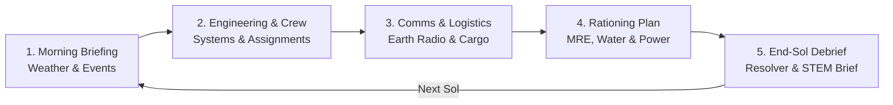
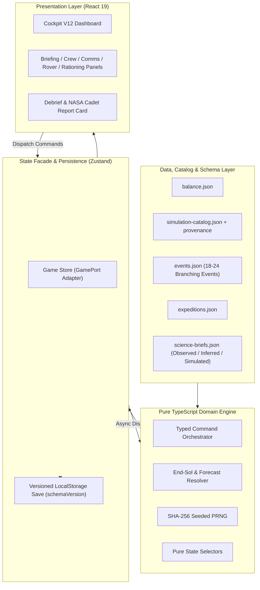

# 🚀 Project Hail — Junior Astronaut Mission Trainer

[](https://react.dev/)
[](https://www.typescriptlang.org/)
[](https://vitejs.dev/)
[](https://api.nasa.gov/)
[](LICENSE)
[](#)

> **A 2D turn-based survival strategy & STEM educational web game empowering junior astronauts (ages 7–12) to command a Lunar Outpost through real engineering trade-offs, authentic NASA space weather data, and the grueling 14-Sol Lunar Night.**

---

## 📖 Table of Contents

- [Overview & Vision](#-overview--vision)
- [Campaign Architecture](#-campaign-architecture)
- [Key Features](#-key-features)
- [5-Phase Daily Gameplay Loop](#-5-phase-daily-gameplay-loop)
- [Game Systems](#-game-systems)
  - [6 Resource Vaults](#1-6-resource-vaults)
  - [4 Core ECLSS Systems](#2-4-core-eclss-systems)
  - [Crew Roster: One Person, One Job, One Sol](#3-crew-roster)
  - [3 Remote Rover Expeditions & Sol 7 Golden Crisis](#4-remote-rover-expeditions--sol-7-golden-crisis)
  - [The 14-Sol Lunar Night Survival (Sol 15–28)](#5-the-14-sol-lunar-night-survival-sol-1528)
- [Cockpit V12 Dashboard & UI Spec](#-cockpit-v12-dashboard--ui-spec)
- [Technical Architecture](#-technical-architecture)
- [Project Structure](#-project-structure)
- [Getting Started](#-getting-started)
- [MVP Scope & Phased Roadmap](#-mvp-scope--phased-roadmap)
- [Pedagogical Impact & STEM Goals](#-pedagogical-impact--stem-goals)
- [Documentation Hub](#-documentation-hub)
- [Contributing](#-contributing)
- [Attribution & References](#-attribution--references)

---

## 🌌 Overview & Vision

Developed for the **NASA Space Apps Challenge** under the *Project Human Frontier* initiative, **Project Hail** places young players in the commander's seat of an advanced Lunar Outpost at the Moon's South Pole.

Instead of testing passive knowledge through multiple-choice quizzes, Project Hail teaches **authentic engineering trade-offs**:
- *Do we risk power reserves to keep the water recycler active, or preserve battery life to maintain communication with our exploration rover during an impending solar energetic particle event?*
- *How do we budget our fission generator and battery banks when the sun sets for 14 continuous days during the extreme cryogenic Lunar Night?*

Every choice incurs immediate costs and delayed consequences across multiple turns. Science is never arbitrary: real historical space weather records from **NASA DONKI** directly govern radiation, solar flux, and station telemetry.

---

## 🗺️ Campaign Architecture

Project Hail is designed with three clean, independent campaigns (as reconciled in [SCOPE_RECONCILIATION.md](docs/product/SCOPE_RECONCILIATION.md)):

```text
PHASE 1 (Current Focus)                 PHASE 2 (Post-Phase 1)
┌───────────────────────────┐           ┌───────────────────────────┐
│       Moon Survival       │           │       Mars Survival       │
│          32 Sol           │           │        Independent        │
│   Dedicated Save/State    │           │    Dedicated Save/State   │
└───────────────────────────┘           └───────────────────────────┘
              ▲                                       ▲
              │                                       │
              └───────────────┬───────────────────────┘
                              │
                    ADVANCED TWO-ARC MODE
                   Moon 32 Sol → Hohmann → Mars
                     (High-difficulty unlock)
```

1. **Phase 1: Moon Survival (32 Sol)**: Self-contained lunar campaign from Sol 1 to Sol 32. Players do not need to launch to Mars to win. Core focus: Rover training, the Sol 7 crisis, surviving the 14-Sol Lunar Night, and post-dawn recovery.
2. **Phase 2: Mars Survival**: Independent campaign with separate saves, featuring MOXIE oxygen generation, global dust storms, and 14-minute radio latency.
3. **Advanced Two-Arc Mode**: Two-stage challenge combining both campaigns via orbital transfer.

---

## ✨ Key Features

- 🎛️ **Cockpit V12 Dashboard**: 16:9 retro cartoon sci-fi cockpit featuring 6 functional modules, 2 interactive storage racks, and a dynamic 2D Canvas Observation Window.
- ☀️ **Authentic NASA Open Data**: Grounded in curated solar timelines from NASA's Space Weather Database of Notifications, Knowledge, and Information (**DONKI**).
- 🌙 **The 14-Sol Lunar Night Challenge**: Face the authentic lunar day/night cycle where solar power drops to 0 kWh for 14 straight sols (Sol 15–28), requiring strict fission power rationing and battery stewardship.
- 🧑‍🚀 **4-Astronaut Crew Roster**: Distinct roles with health, stress, fatigue, and injury tracking under the *"one person, one job, one sol"* assignment rule.
- 🤖 **3 Remote Rover Expeditions**: Explore the *Lunar Crater*, *Regolith Field*, and *Permanently Shadowed Region (PSR)* for water-ice deposits.
- ⚖️ **Sol 7 Golden Crisis**: A signature branching decision: sacrifice rover telemetry to guarantee habitat life support, or spend vital power to save groundbreaking scientific data.
- 📊 **Dynamic Daily STEM Debrief & 5-Sol Trend Predictor**: Plain-language science explanations linking observed data, inferred context, and simulated station impacts.
- 🔁 **100% Deterministic & Replay-Friendly**: A SHA-256 subsystem-seeded Pure TypeScript resolver (`endSolResolver.ts` + `spaceWeather.ts`) produces versioned, canonical JSON results for scenario sharing and automated testing.
- 🌐 **Bilingual (VI / EN)**: Full bilingual Vietnamese and English support across all UI text, briefs, and dialogues.

---

## 🔄 5-Phase Daily Gameplay Loop

Each Sol unfolds across a strictly defined 5-phase state machine:



1. **Morning Briefing & Starlog**: Review NASA space weather telemetry, evaluate active anomalies, and choose initial event responses.
2. **Engineering & Crew Assignment**: Inspect station module integrity, schedule repairs/upgrades, and assign each of the 4 crew members (*one person, one job, one sol*).
3. **Comms & Logistics**: Communicate with Earth (1.3s transmission delay), schedule or monitor rover expeditions, and request cargo resupply missions (4-sol transit time).
4. **Rationing & Power Plan**: Set food (MRE) and water rations, toggle the Water Recovery System (WRS), and prioritize power delivery.
5. **End-Sol Resolving & Debrief**: The deterministic resolver computes daily consumption and outcomes; review the NASA Science Brief and inspect the 5-Sol Trend Predictor.

---

## ⚙️ Game Systems

### 1. 6 Resource Vaults

| Resource | Unit | Starting Level | Max Capacity | Daily Baseline Consumption | Impact |
|---|---|---:|---:|---:|---|
| **Oxygen (`oxygenKg`)** | kg | 80 kg | 100 kg | 0.84 kg / person | Essential for respiration; failure causes critical medical emergency |
| **Clean Water (`waterL`)** | L | 100 L | 120 L | 2.5 L / person | Hydration and health recovery; supplemented by WRS recycler |
| **Waste Water (`wasteWaterL`)** | L | 10 L | 100 L | Generated daily | Recycled into clean water via WRS (90%–95% efficiency) |
| **Food / MRE (`foodKg`)** | kg | 60 kg | 100 kg | 0.62 kg / person | Daily caloric intake; rationing reduces morale and increases fatigue |
| **Spare Parts (`partsKg`)** | kg | 15 kg | 50 kg | 2 kg / repair | Consumed when repairing broken systems or performing upgrades (4–8 kg) |
| **Battery Bank (`batteryKWh`)** | kWh | 45 kWh | 60 kWh | Buffer storage | Critical energy reservoir during peak demand and the 14-Sol Lunar Night |

### 2. 4 Core ECLSS Systems

1. **CO2 Scrubber**: Removes toxic exhaled carbon dioxide; system degradation causes rapid crew fatigue and incapacitation.
2. **Water Recycler (WRS)**: Purifies greywater into potable water; Lv1 recovers 90% at 4 kWh, while Lv2/Lv3 recover 95% (Lv3 uses 3 kWh).
3. **Power Grid (Fission + Solar)**:
   - **Mini Fission Generator**: Delivers continuous baseline power (**8 kWh/Sol**) regardless of day or night.
   - **Solar Array**: Generates **25 kWh/Sol** during daytime; drops to **0 kWh/Sol** during Lunar Night.
   - **Base Station Load**: Consumes **12 kWh/Sol** minimum essential load.
4. **Airlock Module**: Pressure seal maintaining atmospheric integrity; worn seals lead to continuous cabin gas depressurization.

### 3. Crew Roster

- **4 Astronauts**: *Alex Rivera* (Commander), *Elena Chen* (ECLSS Engineer), *Marcus Adebayo* (Geologist), *Aoi Tanaka* (Systems Specialist).
- **Attributes**: `Health (0–100%)`, `Stress`, `Fatigue`, `Hunger`, `Thirst`, `Condition` (`Available`, `Busy`, `Tired`, `Injured`, `Incapacitated`).
- **Core Rule**: Exactly **1 primary assignment per crew member per Sol**.

### 4. 3 Remote Rover Expeditions & Sol 7 Golden Crisis

Surface exploration is conducted via uncrewed robotic rovers:
1. **Expedition 1 (Sol 1–4) — Lunar Crater**: Impact geology and rock sampling; hazard of rough terrain and wheel slippage.
2. **Expedition 2 (Sol 5–8) — Regolith Field**: Electrostatic dust adhesion and abrasive wear; tests comms antennas and dust mitigation.
3. **Expedition 3 (Sol 9–12) — Permanently Shadowed Region (PSR)**: Sub-zero cryogenic extremes (-240°C); targets volatile water-ice deposits.

#### ⚖️ The Sol 7 Golden Crisis
At Sol 7, a simultaneous cabin leak, solar degradation, and rover telemetry failure strike. Elena Chen is the only available astronaut remaining:
- **Option A (Save Rover)**: Spend 2 kWh and postpone the WRS recycler to rescue rover data; Expedition 2 succeeds, leaving the station with 25.0 L water and 2 kWh battery.
- **Option B (Protect Habitat)**: Run the WRS recycler to safeguard water reserves; abandon rover comms deadline. Expedition 2 fails (rover survives for Expedition 3), leaving 34.0 L water and 0 kWh battery.

### 5. The 14-Sol Lunar Night Survival (Sol 15–28)

The Moon's 28-day diurnal cycle produces **14 Earth days of continuous darkness**:
- Solar power generation drops to **0 kWh**.
- Total generation is capped at the Fission unit's **8 kWh/Sol** against a **12 kWh/Sol** baseline load.
- Players must survive on pre-charged battery reserves, emergency cargo deliveries, non-essential load shedding, and tightened rations until sunrise at Sol 29.

---

## 🎛️ Cockpit V12 Dashboard & UI Spec

The Cockpit V12 layout provides an intuitive retro cartoon sci-fi interface:
- **Observation Window (2D Canvas)**: Renders the dynamic lunar horizon across day, sunset, 14-Sol night (starfield & Earth view), sunrise, and solar storms.
- **Left Rack**: ECLSS Scrubber & WRS Recycler controls, Power Grid meters, and Storage Tanks.
- **Right Rack**: Earth Comms array, Rover Telemetry station, and Science Tools (reflecting live counts of MRE boxes, First Aid kits, Sample Canisters, and Core Drill).
- **Bottom Deck**: 4 Astronaut vitals, status badges, and the 5-Phase Action Controller.
- **5-Sol Resource Predictor**: Visual projection graph calculating whether current settings will deplete resources over the next 5 sols.

---

## 🏗️ Technical Architecture



### Engineering Principles
- **Pure TypeScript Runtime**: End-Sol, forecast, state transitions, and DONKI probability models run locally without Python, Pyodide, or a sidecar service.
- **Single Simulation Authority**: The TypeScript domain resolver is the only source of End-Sol and forecast calculations.
- **Strict Determinism**: Replaying the same `(state with committed plan, seed, modelVersion, catalogVersion)` yields the same canonical response/hash.
- **Fail Closed**: Validation, persistence, or version failures leave `GameState` unchanged and expose a recoverable error.
- **Versioned LocalStorage**: Saves include schema, content, model, and catalog versions with migration/compatibility checks.

---

## 📁 Project Structure

```text
project-human-frontier/
├── .github/
│   ├── workflows/ci.yml         # CI: Lint, Typecheck, Unit Tests, Build
│   └── pull_request_template.md # PR guidelines and review checklist
├── docs/                        # Complete Documentation Hub
│   ├── README.md                # Documentation index & map
│   ├── product/                 # Scope reconciliation & product vision
│   ├── architecture/            # Pure TS engine, state machine, data contracts
│   ├── game-design/             # GDD, balance formulas, event tree, rover specs
│   ├── ui-ux/                   # Cockpit V12 specs, wireframes, accessibility
│   ├── asset-pipeline/          # WebP/SVG specifications, Web Audio guidelines
│   └── plan/
│       ├── first-phase/         # Phase 1.1 - 1.6 plans, master plan, team execution
│       └── second-phase/        # Phase 2 Mars campaign placeholder
├── public/
│   └── assets/hail/             # Cockpit backgrounds, crew portraits, UI assets
├── src/
│   ├── app/                     # Bootstrap, providers, error boundaries
│   ├── components/              # Shared UI primitives (gauges, buttons, cards)
│   ├── features/                # UI feature modules (briefing, crew, comms, rover, etc.)
│   ├── domain/                  # Commands, resolver, PRNG, invariants, selectors
│   ├── data/                    # Static balance, campaign, NASA DONKI/Diviner catalogs
│   ├── persistence/             # Versioned SaveEnvelope and recovery adapter
│   ├── schemas/                 # Runtime validation for content, commands, and saves
│   ├── store/                   # Zustand GamePort and non-persisted UI store
│   ├── types/                   # Strict domain TypeScript definitions
│   ├── utils/                   # Math, formatters, audio synthesis helpers
│   ├── App.tsx                  # Root component
│   └── main.tsx                 # Entrypoint
├── tests/                       # Unit, golden scenarios (Sol 7), and E2E simulation
├── package.json
├── tsconfig.json
└── vite.config.ts
```

---

## ⚡ Getting Started

### Prerequisites
- **Node.js**: `v20.x` or higher
- **npm** or **pnpm**

### Installation & Development

1. **Clone the repository**:
   ```bash
   git clone https://github.com/your-username/project-human-frontier.git
   cd project-human-frontier
   ```

2. **Install dependencies**:
   ```bash
   npm install
   ```

3. **Start local development server**:
   ```bash
   npm run dev
   ```
   Open your browser at `http://localhost:5173`.

4. **Code verification scripts**:
   ```bash
   npm run lint        # Code linting via Oxlint / ESLint
   npm run typecheck   # Strict TypeScript typechecking
   npm test            # Automated engine & resolver unit tests
   npm run build       # Production bundle build
   ```

---

## 🗺️ MVP Scope & Phased Roadmap

### Phase 1: Moon Survival 32 Sol (Current Scope)
- [x] Official Product Scope Reconciliation & 3-Campaign Architecture.
- [x] Technical foundation: Vite + React + TypeScript + CI workflow.
- [x] Phase 1.1: Domain state, command handlers, and versioned save system (`SaveEnvelope v4`).
- [x] Phase 1.2: Crew management, inventory, `3D Fabricator`, and 3-expedition rover lifecycle.
- [x] Phase 1.3: 22 branching VI/EN events and Sol 7 Golden Crisis.
- [x] Phase 1.4: 14-Sol Lunar Night balance, load shedding, and NASA Cadet Report Card.
- [x] Phase 1.5: Tactile Cockpit UI, 2D ambient canvas, Web Audio, asset manifest, and bilingual VI/EN copy.
- [ ] Phase 1.6: Bundle/asset budget, `ErrorBoundary`, accessibility polish, 5-journey E2E gate & release.

### Phase 2: Mars Survival Campaign (Independent)
- [ ] Standalone 36+ Sol Mars expedition.
- [ ] Atmospheric dust storms, MOXIE systems, and 14-minute radio communication latency.

### Phase 3: Advanced Two-Arc Mode
- [ ] Integrated campaign connecting Moon Survival to Mars via Hohmann transfer orbital trajectory.

---

## 🎓 Pedagogical Impact & STEM Goals

1. **Systems Thinking**: Children observe firsthand how biological, mechanical, and electrical subsystems interact under extreme planetary limitations.
2. **Scientific Integrity**: Distinguishes between **Observed Data** (direct NASA DONKI records), **Inferred Context** (scientific deductions), and **Simulated Gameplay** (game mechanics).
3. **Resilience & Calculated Risk**: Teaches players to weigh competing trade-offs calmly rather than relying on twitch reflexes or blind chance.

---

## 📚 Documentation Hub

For in-depth design specifications, architecture blueprints, and execution plans, visit the [`docs/`](docs/README.md) hub:
- 📑 [Scope Reconciliation](docs/product/SCOPE_RECONCILIATION.md): Definitive 3-campaign roadmap and release gates.
- 🏗️ [System Architecture](docs/architecture/SYSTEM_ARCHITECTURE.md): Pure TypeScript engine, static NASA catalogs, Zustand store, and data contracts.
- 🧩 [Phase 1.1 State Contract](docs/plan/first-phase/PHASE_1_1_STATE_CONTRACT.md): Authoritative GameState fields, resolver contract, save envelope, and invariants.
- 🎮 [Game Design Document](docs/game-design/GAME_DESIGN_DOCUMENT.md): Complete balance formulas, resource economics, and rover systems.
- 🎛️ [Cockpit V12 Specifications](docs/ui-ux/COCKPIT_V12_SPEC.md): 16:9 cockpit layout, 6 modules, 2 racks, and Observation Window.
- 🎨 [Asset & Audio Pipeline](docs/asset-pipeline/ASSET_SPECIFICATION.md): WebP/SVG standards, Web Audio procedural SFX, and NASA attributions.
- 🗓️ [Phase 1 Implementation Plans](docs/plan/first-phase/): Detailed step-by-step technical plans from Phase 1.1 to Phase 1.6.

---

## 🤝 Contributing

Contributions are welcome! Please read our [Contributing Guidelines](CONTRIBUTING.md) for branch conventions, Conventional Commits formatting, PR checklist, and code standards.

---

## 📜 Attribution & References

- **Full Credits & NASA Open Data Notice**: See [CREDITS.md](CREDITS.md) and [LICENSE](LICENSE).
- **NASA Space Apps Challenge**: Junior Astronaut Mission Trainer challenge track.
- **NASA Open Data**: NASA DONKI (Space Weather Database Of Notifications, Knowledge, and Information) API, NASA LRO Diviner & LOLA (PDS), and NASA OSDR RadLab.
- **Educational Framework**: Next Generation Science Standards (NGSS) Earth and Space Sciences.

---

*Project Hail is developed with passion for the junior astronauts and space explorers of tomorrow.* 🛰️🌕
