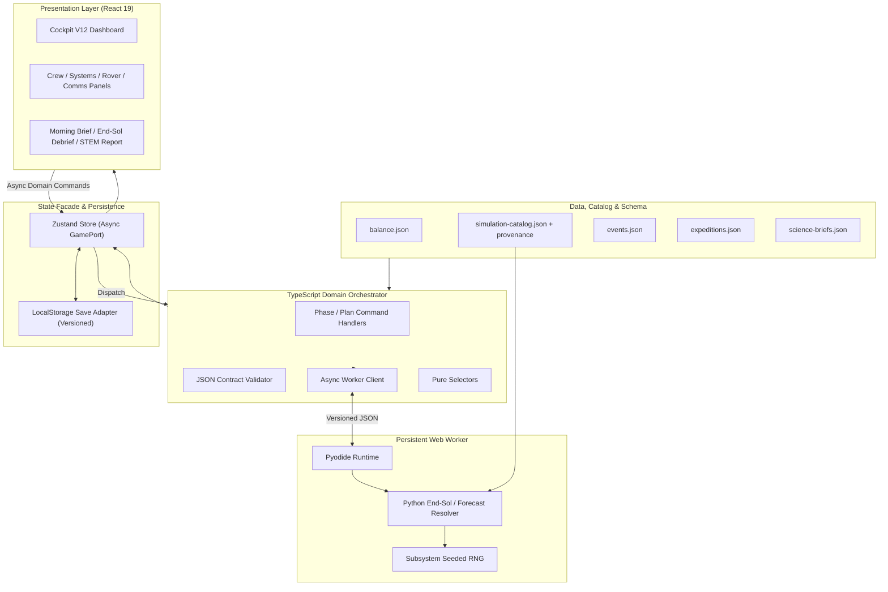

# 🏗️ Kiến trúc Hệ thống — Project Hail

> Căn cứ theo kế hoạch kỹ thuật tại `PHASE_1_1_STATE_FOUNDATION_PLAN.md`, [`PHASE_1_1_STATE_CONTRACT.md`](../plan/first-phase/PHASE_1_1_STATE_CONTRACT.md) và `PHASE_1_MOON_IMPLEMENTATION_PLAN.md`.

---

## 1. Nguyên Tắc Cốt Lõi (Core Architectural Tenets)

1. **Pyodide Web Worker Simulation**:
   - Python resolver chạy trong **persistent Pyodide Web Worker** và là nguồn tính toán duy nhất cho End-Sol, forecast và model khoa học.
   - TypeScript quản lý phase, command orchestration, snapshot, store và persistence; không nhân đôi công thức simulation.
   - Main thread không chạy Python hoặc model nặng. Worker không truy cập React, Zustand, DOM và LocalStorage.
   - Hai phía chỉ trao đổi JSON contract đã version hóa và validate.
   - **Deterministic Replay**: cùng `(state có committed plan, seed, modelVersion, catalogVersion)` luôn cho cùng canonical response/hash.
   - RNG được dẫn xuất theo seed và subsystem; nghiêm cấm `Math.random()`, Python RNG global và wall clock trong simulation.

2. **Decoupled State & UI Layer**:
   - Quản lý state thông qua **Zustand store** làm facade/adapter giữa domain orchestrator, worker client và React Components.
   - UI chỉ đóng vai trò hiển thị (presentation) và dispatch domain commands; UI không tự tính toán hay trực tiếp đột biến giá trị tài nguyên.

3. **Data-Driven Architecture**:
   - Toàn bộ chỉ số cân bằng, sự kiện, kịch bản thám hiểm rover và bài học STEM nằm trong các tệp JSON có JSON Schema kiểm thực chặt chẽ (`src/data/*.json`).
   - Raw NASA data được calibration ngoài runtime; game chỉ đóng gói `simulation-catalog.json` nhỏ cùng provenance `observed | inferred | assumption | simulated`.

4. **Versioned Save State**:
   - Lưu trữ tiến trình chơi qua LocalStorage với `schemaVersion`, `contentVersion`, `modelVersion`, `catalogVersion` và cơ chế migration/compatibility check.

5. **Fail Closed**:
   - Worker lỗi, response stale hoặc version mismatch không được sửa `GameState`.
   - UI cho phép retry/reload worker; không fallback sang một resolver TypeScript khác.

---

## 2. Sơ đồ Luồng Dữ Liệu (Data Flow)



---

## 3. Cỗ Máy Trạng Thái 5 Bước Mỗi Sol (Daily State Machine)

Một ngày trên Mặt Trăng (Sol) được chia thành 5 phase nghiêm ngặt:

```text
Title Screen
     │
     ▼
Morning Briefing ──> Engineering ──> Comms & Logistics ──> Rationing Plan ──> Resolving (End-Sol)
     ▲                                                                                │
     │                                                                                ▼
     └────────────────────────── Debrief & STEM Brief ◀───────────────────────────────┘
                                         │
                         (Nếu đạt terminal condition)
                                         ▼
                                Victory / Game Over
```

| Phase | Trách nhiệm chính của người chơi |
|---|---|
| **1. Morning Briefing** | Đọc báo cáo thời tiết vũ trụ NASA DONKI, nhận diện cảnh báo và quyết định lựa chọn sự kiện phát sinh đầu ngày. |
| **2. Engineering & Crew** | Phân công phi hành đoàn (*1 người - 1 việc - 1 Sol*), sửa chữa/nâng cấp hệ sinh thái trạm, quản lý ưu tiên nguồn điện. |
| **3. Comms & Logistics** | Gửi điện tín về Trái Đất (độ trễ 1.3s), điều phối phóng/thu hồi 3 chuyến xe tự hành Rover, yêu cầu tàu hàng tiếp tế (thời gian vận chuyển 4 Sol). |
| **4. Rationing** | Thiết lập khẩu phần ăn (MRE) và nước uống, bật/tắt máy tái chế nước WRS. |
| **5. Resolving & Debrief** | Chốt ngày; Resolver tính toán biến thiên tài nguyên, kiểm tra điều kiện sống còn, xuất báo cáo STEM và biểu đồ xu hướng 5 Sol kế tiếp. |

---

## 4. Cấu Trúc Thư Mục Source Chuẩn (`src/`)

```text
src/
├── app/                     # Bootstrap ứng dụng, Providers, Error Boundary
├── components/              # UI Primitives dùng chung (Buttons, Gauges, Badges)
├── features/                # Các mô-đun UI theo phase gameplay
│   ├── briefing/            # Morning Briefing & Event dialog
│   ├── engineering/         # Điều khiển 4 hệ thống, sửa chữa/nâng cấp
│   ├── crew/                # Bảng phân công 4 phi hành gia
│   ├── comms/               # Vô tuyến Trái Đất & tiếp tế tàu hàng
│   ├── rover/               # Lập kế hoạch 3 chuyến thám hiểm Rover
│   ├── rationing/           # Phân phối khẩu phần & ưu tiên tải điện
│   └── debrief/             # Báo cáo End-Sol, STEM brief & Report Card
├── domain/                  # TypeScript orchestration, không chứa physics
│   ├── commands/            # Phase/plan command handlers
│   ├── selectors/           # Pure state queries
│   └── validation/          # State invariant, guard và domain errors
├── simulation/              # Biên TypeScript ↔ Python
│   ├── simulation.worker.ts # Web Worker entry
│   ├── workerClient.ts      # Async correlation/timeout/retry
│   └── contracts/           # Request/response types + validators
├── data/                    # JSON content đóng gói sẵn
│   ├── balance.json
│   ├── crew.json
│   ├── events.json
│   ├── expeditions.json
│   ├── initial-state.json
│   ├── simulation-catalog.json
│   └── science-briefs.json
├── schemas/                 # JSON Schemas cho dữ liệu và save file
├── store/                   # Zustand store & LocalStorage persistence
├── types/                   # Khai báo TypeScript types chuẩn cho toàn bộ domain
├── utils/                   # Hàm định dạng số liệu, tính toán vật lý, audio
└── styles/                  # Toàn bộ CSS hệ thống
```

Python runtime assets được đóng gói riêng:

```text
public/
├── pyodide/                 # Runtime self-host để offline và cache
└── python/
    └── hail_sim/
        ├── contract.py      # Validate/serialize JSON contract
        ├── resolver.py      # End-Sol và forecast
        ├── rng.py           # Seed dẫn xuất theo subsystem
        ├── models/          # Environment/equipment/crew/resources
        └── version.py       # modelVersion + contractVersion
```

Pipeline calibration dùng Python native/Pandas/SciPy có thể nằm ngoài bundle runtime; output duy nhất game cần là catalog JSON đã version hóa.
