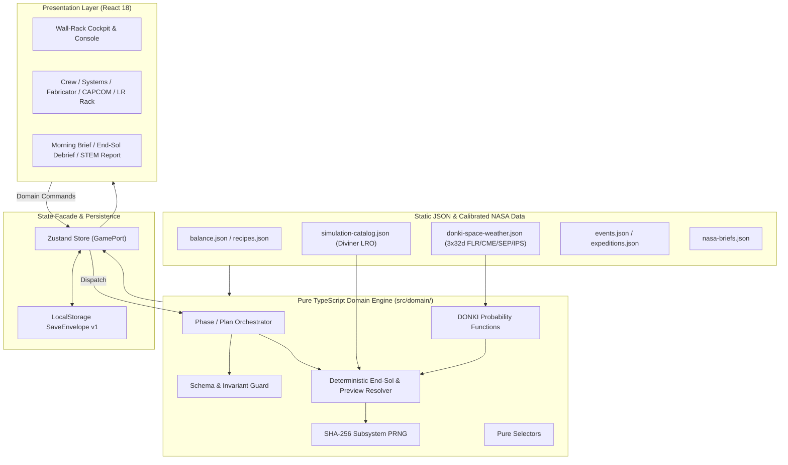

# 🏗️ Kiến trúc Hệ thống — Project Hail

> Căn cứ theo kế hoạch kỹ thuật tại `PHASE_1_1_STATE_FOUNDATION_PLAN.md`, [`PHASE_1_1_STATE_CONTRACT.md`](../plan/first-phase/PHASE_1_1_STATE_CONTRACT.md) và `PHASE_1_MOON_IMPLEMENTATION_PLAN.md`.

---

## 1. Nguyên Tắc Cốt Lõi (Core Architectural Tenets)

1. **Pure TypeScript Deterministic Engine & Static JSON**:
   - Toàn bộ End-Sol resolver, forecast preview và hàm xác suất thời tiết vũ trụ chạy trực tiếp bằng **Pure TypeScript** (`src/domain/`) — không dùng Pyodide Web Worker, không cần Python runtime hay local sidecar khi chơi.
   - Domain engine tách biệt hoàn toàn khỏi React, Zustand, DOM và LocalStorage.
   - Mọi dữ liệu NASA (Diviner LRO nhiệt độ bề mặt từ pipeline offline và 3 mẫu × 32 ngày NASA DONKI space weather) được cào trước, chuẩn hóa và đóng gói thành static JSON có version hóa và validate (`src/data/simulation-catalog.json`, `src/data/donki-space-weather.json`).
   - **Deterministic Replay**: cùng `(state có committed plan, seed, modelVersion, catalogVersion)` luôn cho cùng canonical output/hash.
   - RNG được dẫn xuất theo SHA-256 `(missionSeed, sol, subsystem)`; nghiêm cấm `Math.random()` và wall clock trong simulation.

2. **Decoupled State & UI Layer**:
   - Quản lý state thông qua **Zustand store** (`ZustandGamePort`) làm facade/adapter giữa domain orchestrator và React Components.
   - UI chỉ đóng vai trò hiển thị (presentation) và dispatch domain commands; UI không tự tính toán hay trực tiếp đột biến giá trị tài nguyên.

3. **Data-Driven Architecture**:
   - Toàn bộ chỉ số cân bằng, sự kiện, kịch bản thám hiểm rover, dữ liệu DONKI 32 ngày và bài học STEM nằm trong các tệp static JSON (`src/data/*.json`) có contract/schema kiểm thực chặt chẽ (`src/schemas/`).
   - Raw NASA data được cào & hiệu chỉnh ngoài runtime (`scripts/`); game chỉ đóng gói static JSON nhỏ gọn cùng provenance `observed | inferred | assumption | simulated`.

4. **Versioned Save State**:
   - Lưu trữ tiến trình chơi qua LocalStorage (`SaveEnvelope` v1) với `schemaVersion`, `contentVersion`, `modelVersion`, `catalogVersion`, SHA-256 checksum và cơ chế migration/compatibility check.

5. **Fail Closed**:
   - Validation error, phase mismatch hoặc version mismatch trong command/save không được sửa `GameState`.
   - Khi save lỗi hoặc version không khớp, UI hiển thị cảnh báo khôi phục thay vì âm thầm ghi đè dữ liệu.

---

## 2. Sơ đồ Luồng Dữ Liệu (Data Flow)



---

## 3. Cỗ Máy Trạng Thái 5 Bước Mỗi Sol (Daily State Machine)

Một ngày trên Mặt Trăng (Sol) được chia thành 5 phase nghiêm ngặt:

```text
Title Screen
     │
     ▼
Morning Briefing ──> Engineering ──> Comms & Logistics ──> Rationing Plan ──> Resolving (End-Sol)
     ▲                                                                                │
     │                                                                                ▼
     └────────────────────────── Debrief & STEM Brief ◀───────────────────────────────┘
                                         │
                         (Nếu đạt terminal condition)
                                         ▼
                                Victory / Game Over
```

| Phase | Trách nhiệm chính của người chơi |
|---|---|
| **1. Morning Briefing** | Đọc báo cáo thời tiết vũ trụ NASA DONKI, nhận diện cảnh báo và quyết định lựa chọn sự kiện phát sinh đầu ngày. |
| **2. Engineering & Crew** | Phân công phi hành đoàn (*1 người - 1 việc - 1 Sol*), sửa chữa/nâng cấp hệ sinh thái trạm, quản lý ưu tiên nguồn điện. |
| **3. Comms & Logistics** | Gửi điện tín về Trái Đất (độ trễ 1.3s), điều phối phóng/thu hồi 3 chuyến xe tự hành Rover, yêu cầu tàu hàng tiếp tế (thời gian vận chuyển 4 Sol). |
| **4. Rationing** | Thiết lập khẩu phần ăn (MRE) và nước uống, bật/tắt máy tái chế nước WRS. |
| **5. Resolving & Debrief** | Chốt ngày; Resolver tính toán biến thiên tài nguyên, kiểm tra điều kiện sống còn, xuất báo cáo STEM và biểu đồ xu hướng 5 Sol kế tiếp. |

---

## 4. Cấu Trúc Thư Mục Source Chuẩn (`src/`)

```text
src/
├── app/                     # Bootstrap ứng dụng, Providers, Error Boundary
├── components/              # UI Primitives dùng chung (Buttons, Gauges, Badges)
├── features/                # Các mô-đun UI theo phase gameplay
│   ├── briefing/            # Morning Briefing & Event dialog
│   ├── engineering/         # Điều khiển 4 hệ thống, sửa chữa/nâng cấp
│   ├── crew/                # Bảng phân công 4 phi hành gia
│   ├── comms/               # Vô tuyến Trái Đất & tiếp tế tàu hàng
│   ├── rover/               # Lập kế hoạch 3 chuyến thám hiểm Rover
│   ├── rationing/           # Phân phối khẩu phần & ưu tiên tải điện
│   └── debrief/             # Báo cáo End-Sol, STEM brief & Report Card
├── domain/                  # Pure TS Domain Engine (orchestrator + simulation resolver)
│   ├── orchestrator.ts      # Phase/plan command handlers
│   ├── endSolResolver.ts    # End-Sol & preview forecast resolver
│   ├── spaceWeather.ts      # DONKI probabilistic hazard functions
│   ├── prng.ts              # Deterministic SHA-256 subsystem PRNG
│   ├── invariants.ts        # State invariant, guard và domain errors
│   └── selectors.ts         # Pure state queries & permissions
├── data/                    # Static JSON content & pre-scraped NASA data
│   ├── balance.json
│   ├── crew.json
│   ├── recipes.json
│   ├── campaign-moon32.json
│   ├── donki-space-weather.json
│   ├── events.json
│   ├── initial-state.json
│   ├── simulation-catalog.json
│   └── nasa-briefs.json
├── persistence/             # LocalStorage SaveEnvelope v1 & recovery
├── schemas/                 # Schema validators cho dữ liệu và save file
├── store/                   # Zustand store (`ZustandGamePort`, `uiStore`, `mockGamePort`)
├── types/                   # Khai báo TypeScript types chuẩn cho toàn bộ domain
├── utils/                   # Hàm định dạng số liệu, âm thanh
└── styles/                  # Toàn bộ CSS hệ thống
```

Scripts cào & hiệu chỉnh dữ liệu NASA (`scripts/`) chạy offline bằng Node (không đưa `NASA_API_KEY` vào bundle trình duyệt); game chỉ đọc các tệp static JSON trong `src/data/`.
