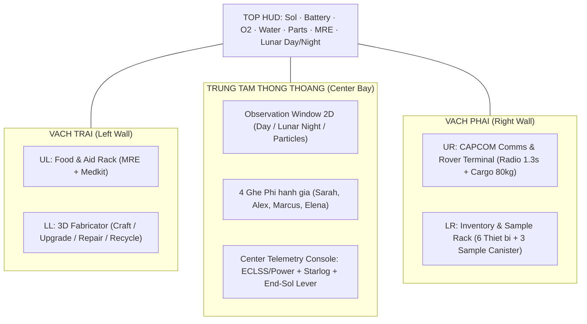
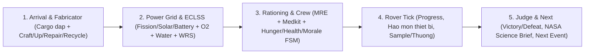
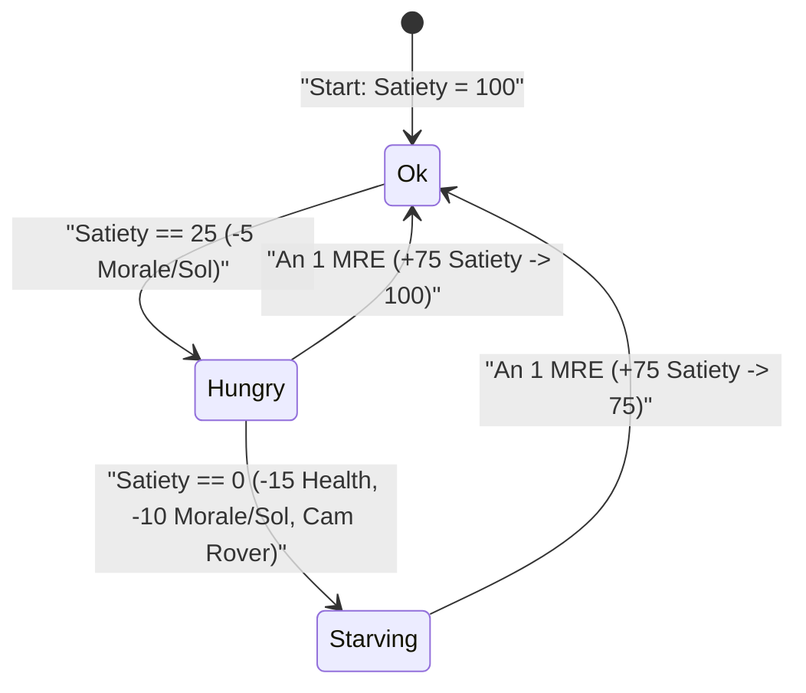
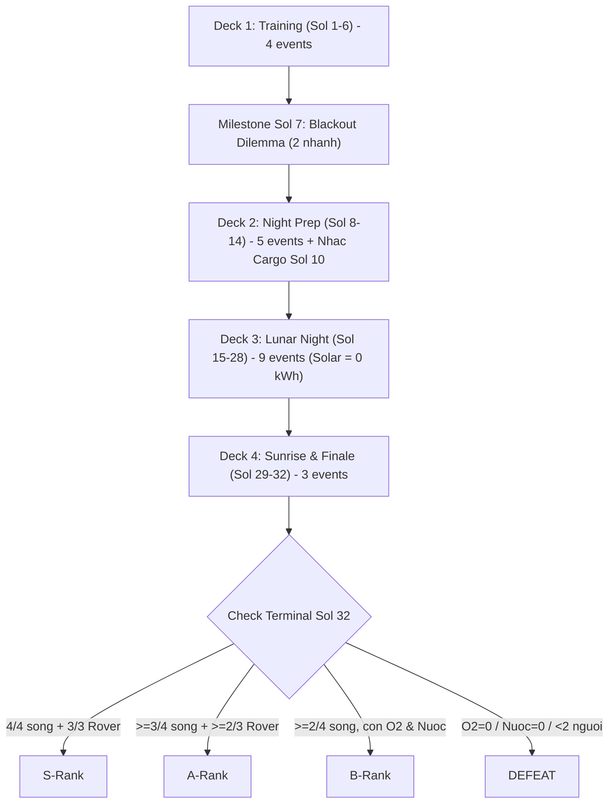

# HUMAN FRONTIER 2050+ — Tài liệu Thiết lập Gameplay Tổng hợp (`Moon 32 Sol · Phase 1`)

> **Mục đích:** Đây là **tài liệu thiết kế gameplay hợp nhất duy nhất** dùng để cả team (Engine/Web Dev · Content/STEM · Art/UI-UX) triển khai thống nhất bản Phase 1: **Moon Survival 32 Sol** (*Artemis Base Camp*, đối tượng học sinh 7–12 tuổi).
>
> **Triết lý thiết kế (NASA STEM + KISS theo *60 Parsecs!*):**
> - Giữ **độ chân thực khoa học NASA** ở công thức nền & bài giảng *NASA Science Brief* (`O₂ ~0.85 kg`, Nước `2.5 L`, `WRS 90%/95%`, Đêm Trăng `14 Sol`, Cargo `4 Sol`, Radio `1.3s`).
> - Áp dụng **KISS** cho toàn bộ thông số quản lý: `4` kho chính + `MRE/Medkit`, bậc số tròn (`5 / 10 / 20 / 25`), độ đói `Ok → Hungry → Starving`, `3D Fabricator` + `6` thiết bị Rover gắn với `BlockThreat`.
> - **Bản quyền:** 0% tài nguyên/tên/code của *60 Parsecs!* hoặc *Robot Gentleman*; chỉ kế thừa mô hình game loop & quản lý.
> - **Phạm vi tách biệt:** Màn `mars-survival` và `moon-to-mars-advanced` giữ tách biệt theo `campaignId`, không chen vào release gate Phase 1.

---

## Mục lục
1. [Bố cục Cockpit Mới (`Wall-Rack Consolidation`)](#1-bố-cục-cockpit-mới-wall-rack-consolidation)
2. [Vòng lặp Chơi trong 1 Sol & Thứ tự Engine 5 Bước](#2-vòng-lặp-chơi-trong-1-sol--thứ-tự-engine-5-bước)
3. [Tài nguyên, Điện năng & Cargo Tiếp tế `80 kg`](#3-tài-nguyên-điện-năng--cargo-tiếp-tế-80-kg)
4. [Phi hành đoàn: Vai trò & Máy trạng thái (`Health / Morale / Hunger`)](#4-phi-hành-đoàn-vai-trò--máy-trạng-thái-health--morale--hunger)
5. [Hệ thống Tàu (`Console`) · `3D Fabricator` · Kho đồ `2 + 6`](#5-hệ-thống-tàu-console--3d-fabricator--kho-đồ-2--6)
6. [Thám hiểm Rover (`3 Sites` · `BlockThreat`)](#6-thám-hiểm-rover-3-sites--blockthreat)
7. [Game Tree 32 Sol: Pacing Decks, Golden Sol 7 & Thắng/Thua](#7-game-tree-32-sol-pacing-decks-golden-sol-7--thắngthua)
8. [Checklist Thực thi theo Vai trò Team](#8-checklist-thực-thi-theo-vai-trò-team)

---

## 1. Bố cục Cockpit Mới (`Wall-Rack Consolidation`)

Thay vì treo 3 máy hạ tầng nặng nề (`Oxygen Generator`, `Water Recycler`, `Power Module`) trên vách và đặt 2 tủ che giữa màn hình, toàn bộ số liệu kỹ thuật tàu được đưa vào **Telemetry Console** ở bàn trung tâm; **2 Rack được dời ra 2 vách** cùng **3D Fabricator** và **CAPCOM Comms** để trung tâm buồng lái rộng thoáng cho **Cửa sổ Quan sát** và **4 ghế phi hành gia**.

### Quy hoạch 5 Điểm tương tác & Asset cho Artist / UI (`1672×941`, `16:9` — Bắt buộc P0)

| Vị trí | Thành phần | Chức năng khi Click | Trạng thái Asset (`public/assets/hail/` — Đang được sinh mới đồng bộ) |
| :--- | :--- | :--- | :--- |
| **Góc Trên-Trái (`UL`)** | **`Food & Aid Rack`** | Xem `MRE` / `Medkit`, mở bảng **Rationing & Y tế** | Tái dùng / tinh chỉnh từ `PH_EQP_RACK_FOOD_AID_BASE_V12.webp` gắn lên vách `UL` |
| **Góc Dưới-Trái (`LL`)** | **`3D Fabricator`** | Mở xưởng in 3D: `Craft / Upgrade / Repair / Recycle` | Asset mới (`IDLE / WORKING / DAMAGED`) kế thừa mẫu `fabricator_3d_idle.png` |
| **Góc Trên-Phải (`UR`)** | **`CAPCOM & Rover Comms`** | Radio Houston (`1.3s`), đặt **Cargo `80 kg`**, phóng Rover | Giữ vị trí `UR` (`PH_EQP_COMMS_TERMINAL_BASE_V12.webp`) |
| **Góc Dưới-Phải (`LR`)** | **`Inventory & Sample Rack`** | Xem **6 Thiết bị** (`Good/Worn/Damaged`) & **3 Sample**; chọn đồ gắn Rover | Tái dùng / mở rộng từ `PH_EQP_RACK_ARTIFACT_TOOL_BASE_V12.webp` gắn lên vách `LR` |
| **Trung tâm (`Center`)** | **`Telemetry Console` + `4 Ghế` + `Window`** | Tab *ECLSS/Power* (sửa/nâng cấp/WRS ON-OFF) · Tab *Starlog* · Nút *End-Sol* · Giao việc trên ghế | Giữ `PH_EQP_CONSOLE_DESK_BASE_V01`, `PH_EQP_ENDDAY_CONSOLE_BASE_V01`, 4 ghế; **gỡ** `OXYGEN_GENERATOR`, `WATER_RECYCLER`, `POWER_MODULE` khỏi vách |

---

## 2. Vòng lặp Chơi trong 1 Sol & Thứ tự Engine 5 Bước

### 2.1. Trải nghiệm người chơi mỗi ngày (Ban ngày)
1. **Morning Briefing (`Starlog`):** Đọc báo cáo đêm qua và xử lý Event bắt buộc (nếu có).
2. **Engineering (`Telemetry Console` & `3D Fabricator`):** Bật/tắt **WRS**, sửa/nâng cấp hệ thống, đặt tối đa `1` lệnh trên **`3D Fabricator` (máy tự chạy, không tốn người)**, giao việc cho phi hành gia rảnh (`1 người – 1 việc – 1 Sol`).
3. **Comms & Rover (`CAPCOM` & `LR Rack`):** Gửi Radio tư vấn, đặt Cargo `80 kg` (nếu rảnh bãi đáp), hoặc chọn `3` thiết bị phóng Rover.
4. **Rationing (`UL Rack`):** Tick phát **`MRE`** (nếu ai sắp xuống `Hungry/Starving`) hoặc dùng **`Medkit`** chữa `Injured`; kiểm tra **Resource Predictor** dự báo đêm.
5. **End-Sol Debrief:** Gạt cần **End-Sol** → xem tóm tắt biến động và **1 NASA Science Brief** khớp đúng chỉ số vừa xảy ra.

### 2.2. Thứ tự Xử lý Bất biến của Engine (`End-Sol Resolver`)
Mọi selector dự báo (`Resource Predictor`) phải dùng chung chính xác thứ tự resolver này:

- **Quy tắc cắt tải tự động (Load Shedding ở Bước 2):** Nếu `Fission + Solar + Battery` không đủ cho `Essential (12 kWh) + WRS (4 kWh)`, Engine **tự ngắt WRS trước** để giữ trạm sống; chỉ khi vẫn không đủ `12 kWh` mới xảy ra `blackout` (`-10 Health`, `-15 Morale` toàn đội).

---

## 3. Tài nguyên, Điện năng & Cargo Tiếp tế `80 kg`

### 3.1. 4 Kho Chính + Vật tư Tiêu hao (Không thêm `Chemicals`)
`wasteWaterL` được engine quản lý ngầm để xử lý tái chế qua WRS, không hiện thành kho thao tác tay trên HUD.

| Kho / Vật tư | Đơn vị | Khởi đầu `Sol 1` | Trần kho | Định mức & Quy luật NASA |
| :--- | :--- | :---: | :---: | :--- |
| **`Battery`** | `kWh` | `40` | `60` | Fission nền: `+8 kWh/Sol` (luôn có) · Solar Lv1: `+24 kWh/Sol` (ngày) · **Đêm Trăng (`Sol 15–28`): Solar = `0`** · Tải thiết yếu: `12 kWh/Sol`. |
| **`O₂`** | `kg` | `70` | `120` | Tiêu thụ tự động **`0.85 kg / người sống / Sol`** (`3.4 kg/Sol` cho 4 người). |
| **`Water`** | `L` | `80` | `160` | Tiêu thụ tự động **`2.5 L / người sống / Sol`** (`10.0 L/Sol` cho 4 người); WRS thu hồi **`90%`** (Lv1) hoặc **`95%`** (Lv2/Lv3). |
| **`Parts`** | `kg` | `16` | `60` | Dùng sửa/nâng cấp 5 hệ thống tàu và in/sửa thiết bị trên `3D Fabricator`. |
| **`MRE`** (`UL Rack`) | `gói` | `24` | `60` | `1 gói ≈ 0.62 kg`. Tick phát thủ công cho từng người để hồi độ no. |
| **`Medkit`** (`UL Rack`) | `liều` | `2` | `6` | Dùng chữa `Injured` và hồi máu. |

### 3.2. Bộ Bậc Số Chuẩn cho Toàn bộ Sự kiện (`Event Presets`)
Mọi node trong `events.json` chỉ chọn từ bảng hằng số này để đảm bảo dễ cân bằng:
- **Nhân sự (`Health / Morale / Satiety`):** `TINY = 5` · `SMALL = 10` · `MEDIUM = 20` · `LARGE = 30`.
- **Vật tư:** `Pin (±8 / ±16 / ±24 kWh)` · `Nước (±10 / ±20 L)` · `O₂ (±5 / ±10 / ±15 kg)` · `Phụ tùng (±2 / ±4 kg)` · `MRE (±2 / ±4 gói)`.

### 3.3. Cargo Tiếp tế từ Trái Đất (`80 kg = 4 Slot × 20 kg`)
- **Thời gian bay:** **`4 Sol`** tới Mặt Trăng (`transitSols = 4`), thời gian hồi bãi đáp **`1 Sol`** sau khi hàng tới. *(Nhắc đặt muộn nhất ở Sol 10 để kịp nhận hàng trước Đêm Trăng Sol 15).*
- **Menu 4 gói đồng giá `20 kg/slot`** (bấm `+ / -` chọn tối đa 4 gói):
  1. **Gói Oxy (`20 kg`):** `+20 kg O₂`.
  2. **Gói Nước (`20 kg`):** `+25 L Water`.
  3. **Gói Lương thực & Y tế (`20 kg`):** `+10 MRE` + `1 liều Medkit`.
  4. **Gói Pin & Phụ tùng (`20 kg`):** `+25 kWh Battery` + `+6 kg Parts`.

---

## 4. Phi hành đoàn: Vai trò & Máy trạng thái (`Health / Morale / Hunger`)

### 4.1. 4 Nhà Khoa học & Luật Phân công
- **Quy tắc bất biến:** **1 người – tối đa 1 việc – 1 Sol** (`repair-system`, `upgrade-system`, `rover-operate`, `emergency-response`, `medical-care`, `rest`). Không có bảng chỉ số `AGI/INT/STR`. *(Lưu ý: `3D Fabricator` tự chạy hoàn toàn theo tài nguyên, không chiếm lượt nhân sự.)*

| ID | Họ tên | Chức danh (`Role Tag`) | Kỹ năng Chuyên môn (Rõ ràng 1 dòng) |
| :--- | :--- | :--- | :--- |
| `cmd` | **Sarah Chen** | `Commander` | Miễn nhiễm tụt `Morale` khi nhận nhiệm vụ xử lý khủng hoảng / CAPCOM. |
| `eng` | **Alex Rivera** | `Engineer` | Sửa hệ thống về `100%`; giảm **`1 kg Parts`** khi nâng cấp hệ thống tàu trên Console (tối thiểu `1 kg`). |
| `doc` | **Marcus Vance** | `Medic` | Dùng `Medkit` hồi thêm **`+20 Health`**; thực hiện `medical-care` hồi `+15 Morale` cho đồng đội được chăm sóc. |
| `geo` | **Elena Rostova** | `Geologist` | Trực phóng/thu hồi Rover giúp **giảm `50%` hao mòn độ bền** cho toàn bộ thiết bị gắn theo Rover. |

### 4.2. Ba Thanh Chỉ số & Hysteresis chống nhấp nháy
1. **`Health` (`0–100`, khởi đầu `80`):**
   - `>= 50` → `Fit`.
   - `< 50` (chỉ hồi về `Fit` khi `>= 65` hoặc dùng `Medkit`) → **`Injured`** (cấm sửa hệ thống nặng & trực Rover; chỉ được `Rest` hoặc `Medical Care`).
   - `<= 0` → **`Evacuated`** (rời nhiệm vụ vĩnh viễn, không thể phân công).
2. **`Morale` (`0–100`, khởi đầu `80`):**
   - `>= 30` → Bình thường.
   - `< 30` (hồi về bình thường khi `>= 45`) → **`Tired`** (cấm trực Rover & xử lý khẩn cấp; chọn `Rest` hồi `+30 Morale`).
3. **FSM Đói (`Satiety` `0–100`, khởi đầu `100` — Tự động giảm `-25 / Sol`):**

*(Với mức `-25/Sol` và `+75/MRE`, mỗi người trụ được `2–3` Sol mới cần ăn `1 MRE` — tái tạo đúng nhịp căng thẳng phân bổ lương thực của *60 Parsecs!* mà không bắt click phát cơm mỗi ngày).*

---

## 5. Hệ thống Tàu (`Console`) · `3D Fabricator` · Kho đồ `2 + 6`

### 5.1. Năm Hệ thống Tàu (`maxLevel = 3`)
- Nâng cấp: **`4 Parts` (Lv1 → Lv2)** · **`8 Parts` (Lv2 → Lv3)**.
- Sửa chữa khi bị hư hại (`integrity < 1.0`): **`2 Parts`**.

| Hệ thống | Hiển thị trên UI | Cấp 1 | Cấp 2 (`4 Parts`) | Cấp 3 (`8 Parts`) |
| :--- | :--- | :--- | :--- | :--- |
| **`solar`** | Telemetry Console | `24 kWh/Sol` (ngày) | `30 kWh/Sol` | `36 kWh/Sol` |
| **`recycler`** (WRS) | Telemetry Console | Thu hồi **`90%`** · `4 kWh` · Max `20 L/mẻ` | Thu hồi **`95%`** · `4 kWh` | Thu hồi **`95%`** · **`3 kWh`** |
| **`scrubber`** | Telemetry Console | Lọc CO₂ chuẩn | Giảm tác hại bão bụi | Chắn 100% bão hạt/bụi |
| **`airlock`** | Telemetry Console | Chuẩn (`<1.0` rò `-1 kg O₂/Sol`) | Chịu bụi regolith | Chống rò co ngót lạnh `-173°C` |
| **`fabricator`** | **Vách Dưới-Trái (`LL`)** | Mở khóa công thức **Lv1** | Mở công thức **Lv2** | Mở công thức **Lv3** |

### 5.2. Luật `3D Fabricator` (P0 Bắt buộc · Máy tự chạy) & Bảng Công thức `2 + 6` Món
- **Luật hàng đợi:** `3D Fabricator` **tự vận hành không tốn lượt phi hành gia** (chỉ tốn tài nguyên + điện); mỗi Sol đặt **tối đa `1` lệnh** (`Craft`, `Upgrade`, `Repair`, hoặc `Recycle`), hoàn tất cuối Sol thứ `1` hoặc `2` theo công thức.
- **Độ bền thiết bị (`6` Equipment):** `Good (100%)` → `Worn (50%)` → `Damaged (0% — không thể gắn lên Rover/Event)`.
- **Sửa thiết bị (`Repair`):** Tốn **`2 Parts + 2 kWh`** (`1d`) → hồi về `Good (100%)`.
- **Tái chế (`Recycle`):** Phá `1` món nhận lại **`50% Parts`** (làm tròn lên, `1d`).
- **Kho khởi đầu `Sol 1` trên `LR Rack`:** `Core Drill` (`Good`) + `Sealant Tape` (`Good`).

| Món (`id`) | Loại / Rack | Cấp Xưởng | Craft | Upgrade Lv2 | Tác dụng & `BlockThreat` |
| :--- | :--- | :---: | :--- | :--- | :--- |
| **`mre_pack`** | Consumable (`UL`) | Lv1 | `2 Parts + 2 L Water + 4 kWh` (`1d`) | — | `+75 Satiety` (`Ok`) cho 1 người |
| **`medkit`** | Consumable (`UL`) | Lv1 | `3 Parts + 4 kWh` (`2d`) | `4 Parts + 4 kWh` (`1d`) | Xóa `Injured`, `+30 Health` (`Lv2: +50`) |
| **`core_drill`** | Equipment (`LR`) | Lv1 | `4 Parts + 4 kWh` (`1d`) | Giảm 50% hao mòn | Chặn **Địa hình dốc (`Lunar Crater`)** & đào mẫu |
| **`sealant_tape`** | Equipment (`LR`) | Lv1 | `2 Parts + 2 kWh` (`1d`) | Dùng `2` lần trong Event | Bịt rò `Airlock` / sửa khẩn trong Event không tốn `Parts` |
| **`solar_lantern`** | Equipment (`LR`) | Lv1 | `3 Parts + 3 kWh` (`1d`) | `+10 Morale` Đêm Trăng | Chiếu sáng vùng tối (`PSR`) & chống tụt Morale đêm |
| **`dust_shield`** | Equipment (`LR`) | Lv2 | `4 Parts + 4 kWh` (`1d`) | Miễn hao mòn bão bụi | Chặn **Bụi tĩnh điện (`Regolith Field`)** & bão bụi |
| **`radio_repeater`** | Equipment (`LR`) | Lv2 | `4 Parts + 6 kWh` (`1d`) | Giảm 50% chi phí cứu Sol 7 | Hỗ trợ sóng Rover (`Regolith` / `Sol 7`) & CAPCOM |
| **`cryo_thermal_rig`** | Equipment (`LR`) | Lv3 | `6 Parts + 6 kWh` (`1d`) | Miễn tụt Pin phụ trong PSR | Chặn **Lạnh `-173°C` (`PSR`)** & sự cố Đêm Trăng |

---

## 6. Thám hiểm Rover (`3 Sites` · `BlockThreat`)

- **Cơ chế phóng:** Tốn **`4 kWh`**, cần **`1` người trực (`Fit`, không `Starving`, không `Tired`)** tại Sol phóng và Sol thu hồi, hành trình cố định **`3 Sol`** (`Outbound → Exploring → Returning`).
- **Loadout kiểu *60 Parsecs!*:** Trước khi phóng, chọn **tối đa `3` Thiết bị từ `LR Rack`** gắn lên Rover. Thiết bị đạt điều kiện khắc chế sẽ **chặn 100% rủi ro** và nhận đủ thưởng; mỗi thiết bị tham gia bị giảm `50%` độ bền (chỉ còn `-25%` nếu `Elena` trực).

| Chuyến (`Cửa sổ`) | Địa điểm | Hiểm họa (`Threat`) | Điều kiện `BlockThreat` An toàn `100%` | Thưởng (`LR Sample` + Vật tư) |
| :--- | :--- | :--- | :--- | :--- |
| **`EXP-CRATER`** (`Sol 1–4`) | **Lunar Crater** | Địa hình dốc & Đá va chạm | Mang **`Core Drill`** | **`Sample #1`** + `+20 Science` |
| **`EXP-REGOLITH`** (`Sol 5–8`) | **Regolith Field** | Bụi tĩnh điện + Mất sóng Sol 7 | Mang **`Dust Shield`** hoặc **`Radio Repeater`** | **`Sample #2`** + **`+4 Parts`** |
| **`EXP-PSR`** (`Sol 9–12`) | **Permanently Shadowed Region** | Lạnh cực độ `-173°C` & Tối | Mang **`Cryo Thermal Rig`** (hoặc `Solar Lantern` + Pin `>= 20 kWh`) | **`Sample #3`** + **`+20 L Nước`** |

---

## 7. Game Tree 32 Sol: Pacing Decks, Golden Sol 7 & Thắng/Thua

### 7.1. Sơ đồ Tiến trình Pacing & Kết cục (`Sol 1 → Sol 32`)

### 7.2. Danh mục Khung 22 Sự kiện cho Content Designer
1. **Deck 1 — Training (`Sol 1–6`, `4` events):** `evt_sol1_welcome` (Milestone hướng dẫn), `evt_solar_particles` (bão hạt nhẹ), `evt_airlock_dust` (vệ sinh bụi hay chịu flag `airlock_dusty`), `evt_crater_core` (follow-up nếu `EXP-CRATER` xong).
2. **Milestone Bắt buộc (`Sol 7`):** **`evt_sol7_blackout_dilemma`** — Golden Scenario cố định:
   - *Fixture đầu Sol 7:* `waterL = 35.0 L`, `wasteWaterL = 10.0 L`, `Fission = 8 kWh`, `Battery = 8 kWh` (tổng điện `16 kWh`), `Essential = 12 kWh`, `WRS = 4 kWh` (Lv1 `90%`), 4 crew sống (`10.0 L` nước tiêu thụ), chỉ `Elena` rảnh tay.
   - *Nhánh A (Cứu Rover, `-2 kWh`, tắt WRS):* Cuối Sol còn **`25.0 L` nước, `2.0 kWh` pin**; `EXP-REGOLITH` tiếp tục hoàn thành ở Sol 8 (set flag `sol7_saved_rover`).
   - *Nhánh B (Ưu tiên Trạm, bật `WRS 90%`, `-4 kWh`):* Xử lý `10.0 L` tồn + `8.8 L` nước xám phát sinh trong Sol, thu hồi `+16.9 L` → Cuối Sol còn **`41.9 L` nước, `0.0 kWh` pin**; `EXP-REGOLITH` hết hạn thất bại, Rover an toàn cho `EXP-PSR` (set flag `sol7_prioritized_station`).
3. **Deck 2 — Night Prep (`Sol 8–14`, `5` events):** `evt_rover2_aftermath` (theo flag Sol 7), `evt_sol10_last_cargo_window` (Milestone nhắc đặt Cargo Sol 10), `evt_sol12_training_report` (tổng kết nửa đầu), `evt_psr_ice_vein` (follow-up `EXP-PSR`), `evt_sol14_sunset_warning` (Milestone chuyển cảnh hoàng hôn).
4. **Deck 3 — Lunar Night (`Sol 15–28`, `9` events, Solar = `0 kWh`):** `evt_sol15_night_begins` (Milestone Sol 15), `evt_fission_coolant`, `evt_cryo_seal_crack` (nặng hơn nếu còn `airlock_dusty` hoặc giảm nhẹ nếu có `Sealant Tape` / `Cryo Thermal Rig`), `evt_cabin_fever` (giảm nhẹ nếu có `Solar Lantern`), `evt_emergency_load_shed`, `evt_mid_night_resupply`, `evt_dust_electrostatic`, `evt_crew_fatigue_debate`, `evt_fabricator_jam`.
5. **Deck 4 — Sunrise & Finale (`Sol 29–32`, `3` events):** `evt_sol29_sunrise_surge` (lau bụi Solar sau 14 đêm), `evt_sol31_final_inspection`, `evt_sol32_mission_end` (chốt Victory & NASA Cadet Report Card).

### 7.3. Cân bằng Hai Chiến lược Thắng qua Đêm Trăng (`Sol 15–28`)
- **Đường 1 (Bật WRS theo mẻ `20 L` cách ngày):** Chạy WRS `7` lần × `4 kWh` + `56 kWh` tải nền = `84 kWh` thiếu hụt → chỉ cần đặt **`1` gói Pin & Phụ tùng (`+25 kWh`)** trước Sol 14 là đủ vượt đêm với lượng nước mất chỉ `~14 L`.
- **Đường 2 (Tắt WRS suốt đêm):** Tổng thiếu hụt `56 kWh` nằm gọn trong **`60 kWh` Battery**, bù nước bằng **`2–3` gói Nước Cargo (`+50–75 L`)** + **`+20 L` từ `EXP-PSR`**.
- **Thua ngay (Defeat):** Còn `< 2` phi hành gia hoạt động, HOẶC cạn `O₂ <= 0` qua `1` Sol, HOẶC cạn `Water <= 0` qua `2` Sol liên tiếp.

---

## 8. Checklist Thực thi theo Vai trò Team

- **Engine / Web Dev:**
  - Cập nhật `GameState` & `balance.json` theo đúng 4 kho + `MRE` + `Medkit` + `6` Equipment (`durability: 100 | 50 | 0`) + `fabricator` (`Lv1..3`) + `Satiety FSM (100/75/50 -> 25 -> 0)`.
  - Viết `End-Sol Resolver` đúng thứ tự 5 tầng + Load Shedding tự động, khóa Golden Test Sol 7 (`25.0 L / 2.0 kWh` vs `41.9 L / 0.0 kWh`, WRS xử lý nước xám cùng Sol).
- **Artist / UI-UX:**
  - Tích hợp bộ asset Wall-Rack & `3D Fabricator` (`IDLE / WORKING / DAMAGED`) do Lead/User sinh mới và bàn giao: gỡ 3 máy `OXYGEN / WATER / POWER` khỏi vách Cockpit; đặt 2 Rack tại `UL` & `LR`, `3D Fabricator` tại `LL`.
  - Gom toàn bộ thông số & nút sửa/nâng cấp `solar / recycler / scrubber / airlock` vào **Telemetry Console** ở bàn trung tâm; giữ Observation Window & 4 ghế phi hành gia thông thoáng.
- **Content / STEM Designer:**
  - Soạn `22` Events bám sát **Bộ bậc số chuẩn (`5 / 10 / 20 / 30`)** và bảng `Equipment / Role` khắc chế.
  - Gắn `DebriefContext` + `NASA Science Brief` song ngữ `VI / EN` cho từng biến động chính (WRS 90%/95%, Fission 8 kWh trong Đêm Trăng 14 Sol, độ bền thiết bị trước bụi tĩnh điện regolith, In 3D vũ trụ).
- **QA & Tiêu chuẩn Kiểm định Thực tế (Giảm nhẹ cho vừa sức Team):**
  - **Bắt buộc đạt:** Unit tests `End-Sol Resolver` + `Fabricator` + `Hunger FSM`, **Golden Test Sol 7** (`25.0 L / 2.0 kWh` vs `41.9 L / 0.0 kWh`), full deterministic trace (`1` Victory qua Đêm Trăng + `2` Defeat), `Save/Reload` ở các pha chính, `4–5` E2E luồng cốt lõi (Desktop & Mobile dùng được, phím Tab/Esc/tương phản WCAG cơ bản), bundle `< 2.5 MB` / 60 FPS.
  - **Không bắt buộc ở Phase 1 (giảm tải so với spec phase cũ):** Bot mô phỏng 10.000 ván, ma trận 13 E2E chi tiết, chặn cứng `Initial JS <= 150 kB` hay audit Screen Reader toàn diện (chỉ cần chạy smoke ~100 seed kiểm tra không `NaN`/âm/soft-lock).
