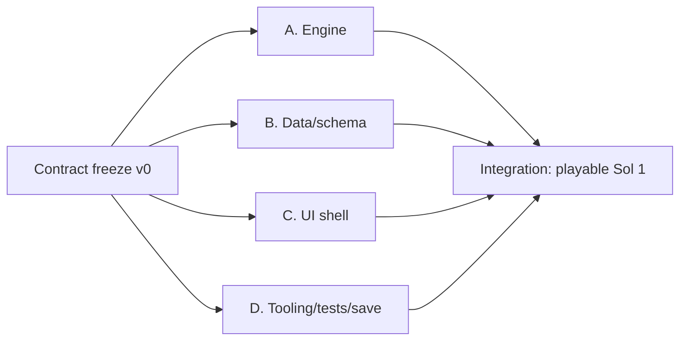

# PHASE 1.1 — State Foundation và kế hoạch triển khai song song

> [!IMPORTANT]
> **CẬP NHẬT STATE & COMMAND (14/11/2026 — Option B):** Giữ nguyên kiến trúc 5 nhóm state + `GameCommand` / `EngineResult` bên dưới, bổ sung/chỉnh theo [`HUMAN_FRONTIER_2050_GAME_SETUP.md`](../../game-design/HUMAN_FRONTIER_2050_GAME_SETUP.md) & [`PHASE_1_SYNC_HANDOFF_FOR_TEAM.md`](PHASE_1_SYNC_HANDOFF_FOR_TEAM.md):
> - Bắt buộc có từ P0: `fabricator` queue (`1` lệnh/Sol, **tự động `0` Crew slot**, `1d/2d`, chỉ tốn `Parts + Battery (+ Water)`), `inventory` (`2` Consumables + `6` Equipment), `crew[i].satiety` (`0–100`) + `HungerState` (`Ok / Hungry / Starving`).
> - Tài nguyên chuẩn: `4` kho hiển thị (`Battery 40/60`, `O2 70/120`, `Water 80/160`, `Parts 16/60`) + `wasteWaterL` ẩn nội bộ; **không** thêm `Chemicals`. `WRS` áp dụng **Option A (`90% -> 95%`)**.

> **Mục tiêu phase con:** từ project trắng tạo được lõi state theo `campaignId` ổn định, deterministic, lưu/khôi phục được và chạy trọn một Sol bằng test — trước khi xây Moon Survival 32 Sol và cockpit hoàn chỉnh.
>
> **Đầu ra quan trọng nhất:** không phải UI đẹp, mà là một `GameState` duy nhất có quy tắc rõ ràng, được thay đổi qua command và không thể rơi vào trạng thái bất hợp lệ.
>
> **Runtime đã chốt:** Python resolver chạy trong Pyodide Web Worker; TypeScript quản lý phase, store, UI và persistence. Hai phía chỉ trao đổi JSON versioned. Chi tiết field và contract nằm tại [`PHASE_1_1_STATE_CONTRACT.md`](PHASE_1_1_STATE_CONTRACT.md).

## 1. Cách quản lý “một mớ state”

Không đặt mọi thứ vào một object Zustand rồi cho component sửa trực tiếp. Chia state thành năm nhóm với năm cách quản lý khác nhau:

| Nhóm | Ví dụ | Nơi quản lý | Có lưu save? |
| --- | --- | --- | --- |
| Domain state | Sol, phase, tài nguyên, crew, hệ thống, rover, event | TypeScript snapshot + Python resolver | Có |
| UI state | Modal đang mở, tab, hover, toast, animation | UI store/local component | Không |
| Draft state | Khẩu phần đang kéo, payload tiếp tế chưa xác nhận | Form/local state | Không; chỉ commit khi xác nhận |
| Content/config | Balance, event catalog, crew, brief | JSON đã validate | Lưu `contentVersion`, không copy cả catalog |
| Derived state | Có sửa được không, dự báo cuối Sol, cảnh báo | Selector thuần | Không |
| Runtime state | Worker loading/ready/error, request đang chạy | Worker adapter/store | Không |

### Quy tắc nguồn sự thật

```text
JSON content/catalog ───────────────┐
                                    ▼
Player command → TS orchestrator → GameState/plan → Store → UI
                         │               │
                         │               └→ Save adapter
                         ▼
                Pyodide Web Worker
                Python resolver
                         │
                         └→ JSON result/effects/diagnostics
```

- `GameState` trong store là snapshot gameplay có thẩm quyền duy nhất.
- TypeScript xử lý phase/plan command; Python là nguồn tính toán duy nhất cho End-Sol và forecast.
- Component không được tự trừ tài nguyên hoặc đổi phase.
- Zustand không chứa công thức gameplay; chỉ giữ snapshot và gọi `dispatch`.
- UI không lưu lại giá trị có thể tính từ `GameState`.
- Save không lưu modal, toast, loading hay form đang nhập dở.
- Thời gian gameplay dùng game clock/command; simulation không đọc `Date.now()`, `Math.random()` hoặc RNG global của Python.
- Worker lỗi hoặc response stale thì giữ nguyên state; không có resolver TypeScript dự phòng.

## 2. Hình dạng state đề xuất

Không cần tách thành hàng chục store. PHASE 1 dùng hai store:

1. `gameStore`: domain snapshot, async dispatch, save/load status và worker runtime status không persist.
2. `uiStore`: modal, selection và presentation state dùng chung.

Form chỉ dùng state cục bộ trong component nếu không cần chia sẻ.

### Domain `GameState`

```ts
interface GameState {
  readonly schemaVersion: 1;
  readonly contentVersion: string;
  readonly modelVersion: string;
  readonly catalogVersion: string;
  readonly revision: number;
  readonly campaign: {
    readonly id: 'moon-32';
    readonly status: 'not-started' | 'active' | 'victory' | 'defeat';
    readonly outcomeReason: string | null;
  };
  readonly clock: {
    readonly sol: number;
    readonly phase: GamePhase;
    readonly missionSeed: number;
    readonly missionElapsedHours: number;
    readonly resolutionIndex: number;
  };
  readonly resources: ResourceState;
  readonly systems: Readonly<Record<SystemId, StationSystem>>;
  readonly crew: Readonly<Record<CrewId, CrewMember>>;
  readonly dailyPlan: DailyPlan;
  readonly rover: RoverState;
  readonly eventQueue: readonly ScheduledEvent[];
  readonly activeEventId: string | null;
  readonly logistics: LogisticsState;
  readonly history: MissionHistory;
}
```

Đây là overview; type chuẩn, mục đích từng field, state không được lưu và invariant nằm trong [`PHASE_1_1_STATE_CONTRACT.md`](PHASE_1_1_STATE_CONTRACT.md). `revision` là bắt buộc để response bất đồng bộ cũ không ghi đè snapshot mới.

### Vì sao dùng record thay vì array cho entity chính

- `crewById['elena']` và `systemsById['recycler']` dễ cập nhật/tra cứu hơn tìm trong array.
- Thứ tự hiển thị nằm trong content/UI (`crewOrder`), không trộn với state.
- Rover mission/history vẫn có thể là array vì thứ tự thời gian có ý nghĩa.

### UI state

```ts
interface UiState {
  readonly activeModal: ModalId | null;
  readonly selectedCrewId: CrewId | null;
  readonly selectedSystemId: SystemId | null;
  readonly selectedRoverSiteId: SiteId | null;
  readonly reducedMotion: boolean;
  readonly locale: 'vi' | 'en';
  readonly queuedToasts: readonly ToastMessage[];
}
```

Không đưa các field sau vào `GameState`:

- `isModalOpen`, `activeTab`, `isHovered`, `isAnimating`.
- `predictedOxygen`, `canRepair`, `crewAvailableCount`.
- Payload/form chưa bấm xác nhận.
- `isSaving`, `loadError` — đây là trạng thái adapter/store.

## 3. Action flow duy nhất

Mọi thay đổi domain phải đi qua command:

```ts
type GameCommand =
  | { type: 'campaign/start' }
  | { type: 'phase/advance' }
  | { type: 'crew/assign'; crewId: CrewId; task: TaskRef }
  | { type: 'crew/unassign'; crewId: CrewId }
  | { type: 'system/repair'; systemId: SystemId }
  | { type: 'system/upgrade'; systemId: SystemId }
  | { type: 'event/choose'; eventId: EventId; choiceId: ChoiceId }
  | { type: 'rover/schedule'; plan: ExpeditionPlan }
  | { type: 'plan/commit'; plan: DailyPlan }
  | { type: 'sol/end' };
```

Engine trả về kết quả có cấu trúc thay vì im lặng:

```ts
type DispatchResult =
  | {
      ok: true;
      state: GameState;
      effects: readonly DomainEffect[];
    }
  | {
      ok: false;
      state: GameState;
      error: DomainError;
    };
```

`DomainEffect` chỉ mô tả điều đã xảy ra (`resource-changed`, `system-repaired`, `phase-changed`). UI quyết định biến effect thành toast, âm thanh hay animation; engine không biết UI.

`dispatch` trả `Promise<DispatchResult>` vì `sol/end`, forecast và validation qua worker là bất đồng bộ. Command phase/plan có thể hoàn tất ngay nhưng vẫn đi qua cùng async interface.

## 4. Derived state bằng selector

Không lưu những gì có thể tính lại:

```ts
selectAvailableCrew(state)
selectCanAdvancePhase(state)
selectCanRepair(state, systemId)
selectResourceForecast(state, config)
selectRoverDeadline(state)
selectMissionProgress(state)
selectBlockingReasons(state)
selectFiveSolResourceTrend(state)
```

Mỗi selector:

- Là pure function.
- Có unit test khi chứa logic quan trọng.
- Trả về lý do chi tiết, không chỉ boolean.
- Được Zustand subscribe theo lát nhỏ để giảm re-render.

Ví dụ:

```ts
type Permission =
  | { allowed: true }
  | { allowed: false; code: string; message: string };
```

## 5. Invariant phải khóa trước khi code gameplay

Đây là “luật hiến pháp” của state:

- `sol` là integer trong `1..32` khi Moon campaign active.
- Mọi resource hữu hạn và không âm; battery không vượt capacity.
- Mỗi crew có tối đa một assignment trong một Sol.
- Crew chết/incapacitated không nhận assignment.
- Một system chỉ có level `1..3`, integrity `0..1`.
- Chỉ một event có thể chờ người chơi xử lý.
- Không advance khỏi briefing khi event bắt buộc chưa giải quyết.
- Không end Sol ngoài pha rationing.
- Rover/equipment đang làm mission không được đặt cho mission khác.
- Mission terminal không nhận command gameplay mới ngoài restart.
- Mỗi cargo/radio/mission/event ID là duy nhất.
- Mọi transition đều tạo log và giữ state cũ immutable.

Viết `assertGameState()` cho development/test và chạy sau mỗi command trong test build.

## 6. Build cái gì trước

### Thứ tự critical path

```text
1. Product rules + invariants
        ↓
2. Domain types + command contract
        ↓
3. JSON schema + fixtures + config loader
        ↓
4. Pyodide worker bootstrap + JSON contract
        ↓
5. TS state machine + Python End-Sol resolver
        ↓
6. Selectors + forecast
        ↓
7. Zustand adapter
        ↓
8. Save/load + migration
        ↓
9. UI vertical slice tối thiểu
        ↓
10. Chạy trọn Sol 1 bằng UI và reload được
```

Không build cockpit hoàn chỉnh trước bước 8. UI sớm chỉ cần dev panel/form tối giản để bấm command và xem state.

## 7. Phạm vi chính xác của PHASE 1.1

### Có trong phase con này

- Project foundation và CI.
- Domain types, command, error, effect và invariant.
- JSON loader/schema cho balance, crew, initial state, worker request/response và simulation catalog.
- Pyodide chạy trong persistent Web Worker, có boot/version/error lifecycle.
- State machine đủ các phase.
- Python Resource/ECLSS resolver cho một Sol.
- Crew assignment cơ bản và sửa chữa một system.
- Selector permission + resource forecast.
- Predictor phải gọi cùng resolver ở chế độ preview; không viết công thức thứ hai trong UI.
- Zustand adapter và hai store.
- Save/load version 1.
- Campaign definition (`targetSol`, victory requirements), Mission Seed và difficulty profile được load từ content/config.
- Dev UI tối thiểu chạy hết Sol 1.
- Test engine, store và persistence.
- Benchmark cold boot, warm resolve và forecast theo budget trong state contract.

### Chưa làm trong phase con này

- Full rover lifecycle và nhánh Sol 7.
- Toàn bộ event catalog/content.
- Artwork cockpit hoàn chỉnh.
- 12-Sol balance, victory/defeat polish.
- Audio, animation, tutorial hoàn chỉnh và NASA live data.

## 8. Kế hoạch triển khai song song

### Điều kiện trước khi tách luồng

Cả team làm chung một nhịp ngắn để khóa:

- Tên domain entity và ID convention.
- `GameState`, `GameCommand`, `DispatchResult` và JSON worker contract bản v0.
- Invariant và phase diagram.
- Folder ownership.
- Fixture Sol 1 và expected output.

Sau khi contract v0 được merge, tách bốn workstream.



### Workstream A — Domain, worker và simulation

**Sở hữu file:** `src/types/`, `src/domain/`, `src/simulation/`, `public/python/`.

- Implement TypeScript state machine, command dispatcher và invariant validation.
- Implement worker client, persistent Web Worker và Pyodide boot lifecycle.
- Implement JSON contract validation ở cả TypeScript và Python.
- Implement crew assignment.
- Implement repair system.
- Implement power/ECLSS End-Sol resolver cho Sol 1 bằng Python.
- Phát `DomainEffect` và `DomainError`.
- Viết unit test domain, Python resolver và determinism trong cùng PR/branch.

**Không làm:** Zustand, component, JSON copy, save adapter.

**Đầu ra:** từ fixture có thể boot worker, gửi một JSON request và nhận state Sol 2 đúng expected snapshot; restart worker rồi replay vẫn cùng output.

### Workstream B — Data, schema và science contract

**Sở hữu file:** `src/data/`, `src/schemas/`, `src/content/`, calibration artifact/manifest.

- Tạo `balance.json`, `crew.json`, `initial-state.json`.
- Tạo schema và decoder/validator cho content, save và worker contract.
- Tạo `simulation-catalog.json` nhỏ từ calibration artifact; không đóng gói raw NASA dataset.
- Định nghĩa `contentVersion`, `modelVersion`, `catalogVersion` và provenance.
- Chuẩn hóa unit/description/source metadata.
- Tạo fixture valid/invalid cho validation.
- Chuẩn bị event/brief mẫu Sol 1, chưa cần full catalog.

**Không làm:** sửa engine types sau contract freeze; thay đổi phải qua proposal.

**Đầu ra:** content bundle typed, validate được, dữ liệu lỗi làm test fail.

### Workstream C — UI foundation và dev vertical slice

**Sở hữu file:** `src/components/`, `src/features/`, `src/styles/`, `src/store/uiStore.ts`.

- Design token và component cơ bản: button, meter, badge, modal, alert.
- Cockpit shell dạng placeholder.
- Dev panel hiển thị phase/resources/crew/system.
- Form local cho assignment và ration plan.
- UI state store cho modal/selection/toast.
- Accessibility foundation: keyboard, focus, reduced motion.
- Dùng mock adapter có cùng interface với game store cho đến lúc tích hợp.

**Không làm:** trừ tài nguyên trong component; copy engine logic vào UI.

**Đầu ra:** UI bấm được full flow Sol 1 với mock result và sẵn sàng thay bằng adapter thật.

### Workstream D — Tooling, persistence và test harness

**Sở hữu file:** config root, `.github/`, `src/store/gameStore.ts`, `src/persistence/`, `tests/` ngoài unit engine.

- Setup TypeScript strict, lint, format, unit/integration/E2E runner.
- Setup CI và coverage/report.
- Implement async `gameStore` facade theo interface đã khóa.
- Implement save envelope, LocalStorage adapter và migration v1.
- Tạo command replay harness và state snapshot viewer.
- Test stale response, worker crash/retry và version mismatch giữ nguyên state.
- Viết integration test store/save/reload.

**Không làm:** gameplay formula hoặc UI component.

**Đầu ra:** snapshot engine có thể dispatch, auto-save, reload và replay.

## 9. Ma trận phụ thuộc giữa các luồng

| Hạng mục | Phụ thuộc | Có thể làm song song? |
| --- | --- | --- |
| Types/commands v0 | Product lock | Không; làm đầu tiên |
| TS state machine + worker protocol | Types/contract v0 | Có với schema/UI/tooling |
| JSON schema/content | Types v0 | Có |
| UI shell/design system | Store interface v0 | Có, dùng mock |
| Save envelope/adapter | GameState v0 | Có |
| Python End-Sol resolver | Balance + JSON contract | A và B phối hợp qua fixture |
| Store integration | Async dispatch + persistence | Chờ A/D hoàn thiện interface |
| Playable Sol 1 | A + B + C + D | Integration gate cuối |

### Những việc tuyệt đối không chia song song

- Hai người cùng thay đổi `GameState` type.
- Hai người cùng định nghĩa công thức balance.
- UI và engine tự tạo hai dạng command khác nhau.
- Data team đổi ID mà không qua contract update.
- Nhiều branch cùng sửa một store lớn.

## 10. Cách tránh conflict khi làm song song

- Mỗi workstream có ownership directory như trên.
- Shared contracts chỉ thay đổi qua PR nhỏ, review bởi đại diện A–D.
- Dùng `contracts-v0.md` hoặc TypeScript types làm giao diện chung.
- UI dùng mock `GamePort`; không import fixture trực tiếp.
- Python resolver nhận state/plan/catalog đã version hóa; không biết Zustand hay React.
- TypeScript không chứa công thức End-Sol/forecast dự phòng.
- Data loader trả đúng `ContentBundle`; không biết Zustand.
- Persistence nhận/ghi `SaveEnvelope`; không biết component.
- Merge contract → schema/data → engine → persistence/store → UI integration.

### Port giúp tách việc

```ts
interface GamePort {
  getSnapshot(): GameState;
  dispatch(command: GameCommand): Promise<DispatchResult>;
  subscribe(listener: () => void): () => void;
  getRuntimeState(): SimulationRuntimeState;
  retryWorker(): Promise<void>;
  reset(): Promise<void>;
}
```

UI có thể dùng `MockGamePort`; integration thay bằng `ZustandGamePort` mà không viết lại component.

## 11. Nhịp tích hợp đề xuất

### Gate 1 — Contract freeze v0

- Phase diagram, state types, async command, JSON request/response, error và invariant đã review.
- Fixture Sol 1 và expected Sol 2 đã chốt.

### Gate 1.5 — Worker ready

- Pyodide boot trong Web Worker, không block main thread.
- Worker báo `modelVersion`/`catalogVersion` và validate được round-trip JSON.
- Worker crash/retry không làm đổi `GameState`.

### Gate 2 — Headless Sol 1

- Harness/test dispatch được: start → briefing → assignment/repair → comms → rationing → end Sol qua worker.
- Nhận state Sol 2, log và delta đúng.
- Không có resource âm hoặc duplicate assignment.

### Gate 3 — Persistence

- Save sau command.
- Reload ở từng phase giữ đúng state.
- Save invalid có lỗi thân thiện và reset recovery.

### Gate 4 — UI integration

- Thay mock bằng game store thật.
- UI không cần đổi command shape.
- Permission/forecast lấy từ selector engine.

### Gate 5 — Playable Sol 1

- Người mới hoàn thành Sol 1 bằng UI.
- Reload giữa Sol và chơi tiếp.
- Test unit/integration/E2E, typecheck, lint và build đều đạt.

## 12. Backlog theo thứ tự merge

| Thứ tự | PR/Deliverable | Luồng |
| ---: | --- | --- |
| 1 | Project scaffold + CI tối thiểu | D |
| 2 | Domain contract v0 + invariants | A, review chung |
| 3 | Content/worker schemas + fixtures Sol 1 | B |
| 4 | Pyodide worker bootstrap + async port | A |
| 5 | Design tokens + primitives + mock port | C |
| 6 | Save envelope + persistence adapter | D |
| 7 | TS state machine + Python Resource/ECLSS resolver | A + fixture B |
| 8 | Async game store + selectors/worker wiring | D + A review |
| 9 | Sol 1 feature panels trên mock | C |
| 10 | Store/UI integration | C + D |
| 11 | Full Sol 1 integration/E2E | D, cả team fix |
| 12 | Phase 1.1 hardening + docs | Cả team |

PR 3–6 có thể chạy đồng thời sau PR 2. PR 5 và 9 không cần chờ engine nếu mock port đã tuân thủ contract.

## 13. Definition of Done PHASE 1.1

- [ ] Chỉ có một authoritative `GameState`.
- [ ] Domain/UI/draft/runtime/content/derived state được phân tách đúng.
- [ ] Không component nào sửa domain state trực tiếp.
- [ ] Tất cả domain mutation đi qua typed command.
- [ ] Python resolver stateless, deterministic; Pyodide chỉ chạy trong Web Worker.
- [ ] TypeScript không có công thức End-Sol/forecast thứ hai.
- [ ] Worker lỗi/stale response/version mismatch không mutate state.
- [ ] Invariant được kiểm tra bằng test.
- [ ] JSON được schema validation và có content version.
- [ ] Selector trả permission kèm lý do.
- [ ] Zustand chỉ làm adapter/snapshot, không chứa công thức gameplay.
- [ ] Save version 1 có validation và recovery.
- [ ] Reload được ở mọi phase trong Sol 1.
- [ ] Sol 1 chạy headless và chạy bằng UI đến Sol 2.
- [ ] Test cùng seed/commands cho cùng state/log.
- [ ] Worker restart rồi replay vẫn cho cùng canonical response/hash.
- [ ] Cold boot, warm resolve và forecast có benchmark theo budget.
- [ ] Typecheck, lint, unit, integration, E2E smoke và build đều đạt CI.
- [ ] Có tài liệu contract và sơ đồ ownership để phase sau không phá kiến trúc.

## 14. Sau PHASE 1.1 build gì tiếp

1. [**PHASE 1.2:** rover lifecycle, ba expedition và crew task đầy đủ](PHASE_1_2_ROVER_CREW_PLAN.md).
2. [**PHASE 1.3:** event system, content catalog và golden scenario Sol 7](PHASE_1_3_EVENTS_SOL7_PLAN.md).
3. [**PHASE 1.4:** full Moon 32, victory/defeat và balance simulation](PHASE_1_4_CAMPAIGN_BALANCE_PLAN.md).
4. [**PHASE 1.5:** cockpit/art/audio/tutorial/educational polish](PHASE_1_5_COCKPIT_POLISH_PLAN.md).
5. [**PHASE 1.6:** accessibility, performance, E2E toàn campaign và release](PHASE_1_6_RELEASE_PLAN.md).

---

## Quyết định ngắn gọn

Build đầu tiên là **contract + engine cho một Sol**, không phải Zustand và không phải cockpit. Sau khi contract v0 khóa, bốn luồng Engine, Data, UI và Tooling/Save chạy song song qua interface chung. Mốc kết thúc PHASE 1.1 là **Sol 1 chơi được, reload được và sang Sol 2 với state đúng**.
