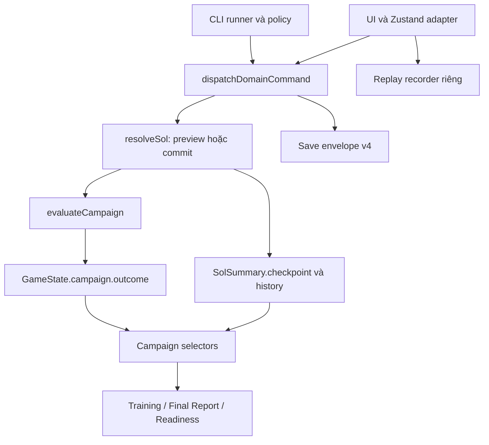

# Phase 1.4 — Ngữ cảnh, nhật ký quyết định và bàn giao triển khai

> **Ngày ghi nhận:** 14/11/2026, múi giờ Asia/Saigon.<br>
> **Dành cho:** thành viên nhóm, reviewer và LLM tiếp nhận công việc.<br>
> **Nhánh hiện tại:** `feat/phase-1-4-campaign-balance`.<br>
> **Trạng thái tại mốc bàn giao:** đã triển khai và kiểm chứng local, trước khi commit/push/PR. Người phụ trách đã yêu cầu xuất bản nhánh qua PR vào `dev` sau mốc này; trạng thái Git/PR thực tế là nguồn kiểm tra việc xuất bản.<br>
> **Phạm vi tài liệu:** mô tả trạng thái code và bằng chứng hiện có, ghi lại câu hỏi/quyết định trong phiên làm việc. Không thay thế hoặc tự sửa kế hoạch chung của nhóm.

## 1. Đọc nhanh để tiếp nhận công việc

Phase 1.4 nối các hệ thống đã có ở Phase 1.1–1.3 thành campaign sinh tồn Mặt Trăng 32 Sol có outcome, rank, báo cáo học tập và bằng chứng chạy xuyên campaign. Công việc gồm cả engine, save, UI, simulation và QA; người phụ trách nhận toàn bộ phase.

Phần triển khai hiện tại có:

- Evaluator thắng/thua tập trung, dùng chung đường resolve cho preview và commit; reason code và rubric S/A/B có cấu trúc.
- Checkpoint sau mỗi End-Sol để giữ dữ liệu lịch sử, Training Report Sol 12 và NASA Cadet Report Card cuối campaign.
- Save schema v4, hỗ trợ chuyển save hợp lệ v1–v3 thuộc các version được nhận diện để tiếp tục theo luật 1.4.
- Runner qua command thật, sáu policy, replay kiểm checksum từng bước, hai victory A/B và hai defeat khác nguyên nhân.
- Checklist Lunar Night, cảnh báo forecast, export snapshot/replay, restart cùng kịch bản hoặc chọn cấu hình mới.
- Sửa thứ tự hủy upgrade và giá upgrade đang xếp; bổ sung invariant capacity/consumable.

Kết quả nghiệm thu đã ghi nhận: **58/58 test pass, 108 campaign smoke chạy và replay xong, bốn campaign đi qua nút UI thật, 0 simulation-error trong smoke và 0 runtime exception trong browser suite**. Typecheck, lint, build và event release validator đạt. Build còn cảnh báo chunk JS >500 kB; chưa đo 60 FPS trên thiết bị thật hoặc tổng tải ban đầu gồm art/audio.

Các kết quả test trong tài liệu là bằng chứng của lượt triển khai đã lưu. Lần tạo tài liệu bàn giao này đối chiếu lại code/artifact; không có nghĩa là vừa chạy lại toàn bộ suite.

## 2. Mốc xuất phát và nguồn ngữ cảnh

### 2.1. Baseline Git

| Mốc | Giá trị và ý nghĩa |
|---|---|
| Hoàn thành phần Phase 1.3 trước đó | `e02450062e5bc6e6259445702f4bec2371dc708c` |
| Base từ `dev` khi bắt đầu Phase 1.4 | `0c578bdd4c32b1b4e8b1d9191f800c82b6bc23b5` |
| Quan hệ hai mốc | `0c578bd` là merge Phase 1.3; tree nội dung tại mốc bắt đầu tương ứng với phần Phase 1.3 đã hoàn tất |
| HEAD tại mốc nghiệm thu local | `0c578bd`; thay đổi Phase 1.4 khi đó nằm trong working tree |
| Nhánh đã dùng ban đầu | `codex/phase-1-4-campaign-balance`, sau đó đổi tên theo yêu cầu người dùng |
| Nhánh bàn giao | `feat/phase-1-4-campaign-balance`, theo cấu trúc trong `CONTRIBUTING.md` |

**Không gọi `0c578bd` là commit hoàn thiện Phase 1.4.** Artifact ghi `buildId` này kèm `workingTreeDirty: true`; cần đọc cùng hash source/content và trạng thái local.

### 2.2. Tài liệu nên đọc theo mục đích

| Tài liệu | Vai trò |
|---|---|
| [Game setup hợp nhất](../../game-design/HUMAN_FRONTIER_2050_GAME_SETUP.md) | Ngữ cảnh gameplay và balance đã đồng bộ |
| [Team sync handoff](PHASE_1_SYNC_HANDOFF_FOR_TEAM.md) | Scope Option B, QA nhẹ hơn và bàn giao giữa phase |
| [Scope reconciliation](../../product/SCOPE_RECONCILIATION.md) | Giới hạn sản phẩm hiện hành |
| [Kế hoạch Phase 1.4 của nhóm](PHASE_1_4_CAMPAIGN_BALANCE_PLAN.md) | Tài liệu gốc của nhóm, đã được giữ nguyên sau khi khôi phục |
| [Implementation & Acceptance](PHASE_1_4_IMPLEMENTATION_AND_ACCEPTANCE.md) | Báo cáo kỹ thuật/nghiệm thu riêng của phần triển khai |
| Tài liệu đang đọc | Tổng hợp bối cảnh, câu hỏi, quyết định, thay đổi, bằng chứng và việc còn mở |
| [Verification manifest](../../../reports/phase-1-4/verification-manifest.json) | Hash source/artifact và kết quả kiểm tra đã ghi nhận; không thay thế đọc code hoặc review |

Bản planning chi tiết của cá nhân nằm ngoài repo chính tại `../documents/PHASE_1_4_FULL_IMPLEMENTATION_PLAN.md`, tính từ thư mục repo. Thành viên chỉ clone repo có thể không có file đó; tài liệu bàn giao này phải đủ để tiếp nhận mà không phụ thuộc file cá nhân.

## 3. Dự án đã có gì trước Phase 1.4?

Game dùng React/Zustand cho UI và TypeScript domain engine cho mô phỏng deterministic. Gameplay tiến qua briefing → engineering → comms → rationing → End-Sol → debrief. Mỗi quyết định được thực thi bằng `GameCommand` qua orchestrator.

Phase 1.1–1.3 đã có engine tài nguyên, crew, rover, fabrication, cargo, NASA DONKI offline, event catalog 22 sự kiện, Golden Sol 7 và Dynamic STEM Brief. Vì vậy Phase 1.4 kế thừa các hệ thống này; không xây lại event engine hoặc rover từ đầu.

| Sol | Vai trò trong campaign |
|---|---|
| 1–4 | Làm quen core loop, Expedition 1 — Lunar Crater |
| 5–8 | Expedition 2 — Regolith Field, khủng hoảng Sol 7 |
| 9–12 | Expedition 3 — Polar PSR, sơ kết training |
| 13–14 | Chuẩn bị dự trữ/cargo/hệ thống trước đêm |
| 15–28 | Lunar Night, solar bằng 0 |
| 29–31 | Sunrise và recovery |
| 32 | Kết thúc campaign và báo cáo cuối |

Baseline có 43 test pass và đã có một đường thắng 32 Sol, nhưng chưa chứng minh đủ expedition/rank hoặc nhiều chiến lược. Outcome cũ chủ yếu là trạng thái và chuỗi `endReason`, chưa có evaluator/rubric/report đầy đủ như hiện tại.

Các số liệu nền được giữ: fission 8 kWh/Sol, essential 12 kWh/Sol, battery capacity 60 kWh, WRS Lv1 90% và Lv2/Lv3 95%, MRE +75 Satiety và hao 25/Sol, cargo 80 kg/4 Sol. Không đưa lại mô hình stress/fatigue cũ vào implementation này.

## 4. Nhật ký câu hỏi và quyết định

Phân biệt hai loại: **xác nhận trực tiếp** là câu trả lời của người phụ trách trong hội thoại; **lựa chọn kỹ thuật** là cách triển khai cụ thể, không được diễn giải thành biểu quyết của toàn nhóm.

### D01 — Luật kết thúc, rank và training: đã xác nhận trực tiếp

**Câu hỏi đã đặt:** có chấp nhận thắng sau End-Sol 32 với ≥2 crew chưa evacuated, O₂ >0 và Water >0; xét defeat trước victory; S = bốn Fit + ba expedition; A = ≥3 active + ≥2 expedition; B = victory còn lại; training chỉ là báo cáo và không thêm integrity gate?

**Câu trả lời:** “Xác nhận bộ luật đề xuất”.

**Hệ quả:** đưa threshold/rubric vào campaign config; không tự thêm điểm WRS, integrity hoặc decision quality vào rank. Các metric đó có giá trị báo cáo/học tập, không phải trọng số chấm điểm ẩn.

### D02 — Difficulty và trường severity chưa hoạt động: đã xác nhận trực tiếp

**Câu hỏi đã đặt:** giữ ID `cadet/standard/hardcore` và `weatherRiskMultiplier` hiện có, ghi rõ `eventSeverityMultiplier` chưa có tác dụng; hay định nghĩa/triển khai effect scaling mới, vẫn bảo vệ Golden Sol 7?

**Câu trả lời:** “Giữ hành vi difficulty hiện tại”.

**Hệ quả:** không scale toàn bộ effect sự kiện. Trường `eventSeverityMultiplier` còn trong config nhưng không được quảng bá là tính năng đang hoạt động.

### D03 — Save cũ: đã hỏi lại để chốt phạm vi

**Đề xuất ban đầu:** nếu thêm persistent metric thì lên v4; migrate save tương thích; với model/balance không tương thích thì giữ raw save, export và bắt đầu ván mới.

**Phản hồi ban đầu của người phụ trách:** “Cần hỗ trợ tiếp tục mọi save cũ (cần chốt phạm vi)”. Đây chưa phải xác nhận phương án từ chối tiếp tục save cũ.

**Câu hỏi làm rõ:** hỗ trợ mọi save hợp lệ schema v1–v3, giữ dữ liệu, tiếp tục theo luật 1.4 và thông báo nâng cấp; file hỏng checksum/sai cấu trúc được giữ để export. Giữ chính xác engine của từng bản cũ sẽ cần các runtime cũ riêng.

**Câu trả lời cuối:** “Hỗ trợ v1–v3, tiếp tục theo luật 1.4 (đề xuất)”.

**Hệ quả:** migration là chuyển dữ liệu sang luật mới, không phải replay tương đương engine cũ. Phạm vi version nguồn được nhận diện và xử lý terminal legacy được ghi tại mục 7.

### D04 — Cách thu thập history và replay: lựa chọn kỹ thuật

Checkpoint nằm trong `SolSummary`, report derive qua selector; recorder nằm ở store/persistence adapter và tách khỏi `GameState`. Cách này giữ công thức gameplay trong domain, tránh UI tự tính rank và tránh lấy thành tích tương lai để dựng training quá khứ.

Runner chỉ dùng API khởi tạo và command thật; không gán resource, clock hoặc kết quả event để tạo victory/defeat trace. Lỗi policy/budget/invariant là `simulation-error`, không phải một defeat của người chơi.

### D05 — Balance: giữ số liệu, bổ sung bằng chứng và sửa guard

Không có tuning số liệu resource/cargo/recipe/crew để làm đẹp kết quả. `balance.json`, `crew.json` và `recipes.json` chỉ đổi metadata version. Thay đổi hành vi có chủ đích nằm ở outcome/ranking/report/migration và guard nâng cấp, không phải tăng tài nguyên cho một seed.

Việc giữ thông số là kết quả triển khai dựa trên các đường sống đã chạy được, không phải bằng chứng rằng balance đã tối ưu cho trẻ em hoặc mọi seed.

### D06 — File kế hoạch chung: sửa nhầm, sau đó khôi phục theo phản hồi

Trong quá trình cập nhật tài liệu, assistant đã viết lại `PHASE_1_4_CAMPAIGN_BALANCE_PLAN.md` để đồng bộ phần thực thi. Cách ghi qua pipeline PowerShell còn làm mất Unicode, biến nhiều ký tự tiếng Việt thành `?`.

Người dùng phản hồi vì đây là kế hoạch chung của nhóm. File đã được khôi phục **khớp từng byte với bản Phase 1.3**, gồm 203 dòng; Git diff nội dung của file so với `e024500` là rỗng. Bản rewrite bị lỗi không phải tài liệu bàn giao hiện hành.

Quy tắc tiếp nhận từ sự việc này: ghi quyết định/kết quả vào tài liệu riêng; không coi các quyết định triển khai trong hội thoại là quyền viết lại kế hoạch chung. Với tiếng Việt, ghi UTF-8 qua cơ chế bảo toàn Unicode và kiểm tra nội dung sau khi ghi.

### D07 — Tên nhánh: đã thực hiện yêu cầu của người dùng

Người dùng yêu cầu đổi tên theo cấu trúc chung. Sau khi đọc `CONTRIBUTING.md`, nhánh local được đổi từ `codex/phase-1-4-campaign-balance` sang `feat/phase-1-4-campaign-balance`; báo cáo riêng/manifest được cập nhật tên. Không push hoặc tạo nhánh remote trong thao tác này.

## 5. Luật hiện đang được code thực thi

### 5.1. Outcome sau End-Sol

Thứ tự trong `evaluateCampaign`:

| Ưu tiên | Điều kiện | Status / reason |
|---|---|---|
| 1 | Crew chưa evacuated <2 | `defeat / crew-collapse` |
| 2 | Oxygen zero streak ≥1 | `defeat / oxygen-depleted` |
| 3 | Water zero streak ≥2 | `defeat / water-depleted` |
| 4 | Đã resolve Sol mục tiêu và đủ tất cả requirement | `victory / moon-victory` |
| 5 | Đã resolve Sol mục tiêu nhưng thiếu requirement | `defeat / final-requirements-unmet` |
| Còn lại | Chưa rơi vào các trường hợp trên | `active`, chưa có reason terminal |

Requirement cuối campaign: resolve đến Sol 32, ≥2 crew chưa evacuated, O₂ >0 và nước >0. Đang ở briefing Sol 32 chưa có nghĩa là đã thắng. Nước bằng 0 lần đầu ở Sol 31 có thể còn active; cùng tình trạng sau End-Sol 32 không đạt điều kiện victory.

Không thêm integrity gate. Nếu crew collapse và cạn O₂ cùng lúc, reason chính theo thứ tự ưu tiên là `crew-collapse`; không đồng nghĩa các vấn đề khác không xảy ra.

### 5.2. Rank và Training Report

| Kết quả | Điều kiện |
|---|---|
| S | Victory + ≥4 crew có `condition === 'fit'` + ≥3 expedition completed |
| A | Victory, chưa đạt S + ≥3 crew chưa evacuated + ≥2 expedition completed |
| B | Các victory còn lại |
| Không rank | Active/defeat; terminal legacy không áp ngược rubric mới |

Expedition completed được đếm theo mission history, không đếm số lần nhận reward. Fit theo FSM hiện có; không tự thêm một điều kiện morale/satiety khác vào rubric.

Training Report đọc checkpoint của summary Sol 12: mục tiêu ≥4 crew chưa evacuated và ≥2 expedition. Không đạt training vẫn tiếp tục campaign nếu chưa defeat. Nếu không có summary Sol 12 thì không có report để đọc; nếu có summary legacy nhưng checkpoint `null`, các check thể hiện thiếu dữ liệu, không đoán từ state hiện tại.

### 5.3. Terminal guard

Gameplay command sau victory/defeat/terminal bị từ chối; `game/start` vẫn khởi tạo được ván mới. Export snapshot/replay là thao tác read-only ở adapter/UI, không phải command gameplay để vượt guard. Không có API mới mang tên `campaign/restart` chỉ để khớp ví dụ cũ trong kế hoạch.

## 6. Luồng kiến trúc và dữ liệu mới



`resolveSol` vẫn là đường mô phỏng dùng chung. Sau expire event, engine xử lý cargo và repair/upgrade, power/ECLSS/WRS và fabrication, crew, rover, rồi cập nhật streak/evaluate outcome, tạo summary/checkpoint và state sau resolve. Checkpoint mới không tạo một công thức gameplay thứ hai.

Các contract bổ sung trong `src/types/index.ts`:

- `CampaignEvaluation`: status, reasonCode, requirements, rank và rankingVersion; được lưu tại `campaign.outcome`.
- `CampaignRequirement`: id, met, actual, target; UI render kết quả thay vì tự tính luật.
- `CampaignCheckpoint`: resources, crew, systems, completedExpeditions, sciencePoints; greywater đã xử lý; solar/fission generated; battery overflow và essential unmet.
- `SolSummary.checkpoint`: checkpoint mới hoặc `null` khi không có dữ liệu lịch sử tương ứng.

WRS efficiency trong report = tổng nước thu hồi của các Sol có checkpoint / tổng greywater thực sự đã xử lý của chính các Sol đó. Không chia cho nước uống và không mặc định một mẻ luôn xử lý đủ 20 L. Denominator bằng 0 trả `null`. Report nêu số Sol đo được để người đọc biết lịch sử đầy đủ hay chỉ một phần.

Timeline dùng highlight/history và occurrence của event đã ghi. Gợi ý học tập theo reason code; không suy ra toàn bộ chuỗi nguyên nhân chỉ từ resource cuối cùng.

Forecast dùng `resolveSol` preview và horizon năm Sol, không viết công thức trong React. Cargo tương lai chỉ là chuyến đã đặt; không tự đặt thêm hàng hoặc ra quyết định event mới. Trong implementation trend hiện có, MRE targets của các Sol tiếp theo được reset, không tự lập kế hoạch cấp MRE mới cho người chơi. Forecast là dự báo có giả định, không bảo đảm thắng.

## 7. Save v4 và compatibility cần hiểu chính xác

| Thành phần version | Giá trị hiện tại |
|---|---|
| `GameState.schemaVersion`, save envelope schema | `4` |
| `saveAdapter.APP_VERSION` | `1.4.0` |
| Content | `1.4.0-moon32` |
| Model | `1.4.0-ts-donki` |
| Ranking | `1.4.0-moon32` |
| Catalog | `1.1.0-moon32` |
| Replay format | `1` |

`package.json.version` hiện vẫn là `1.0.0`; nó không phải `APP_VERSION` trong save adapter. Việc đồng bộ nhãn version phục vụ phát hành là việc cần rà soát riêng, không tự suy ra đã bump mọi version lên 1.4.0.

### 7.1. Đường load

1. Đọc envelope, kiểm schema được hỗ trợ, JSON và checksum của envelope gốc.
2. Kiểm metadata envelope khớp với state.
3. Với legacy, chỉ nhận diện content/model 1.1.0 đang có trong repo hoặc version hiện tại; catalog phải khớp catalog hiện tại.
4. Gọi migration tương ứng v1/v2/v3; hoặc validate v4 và kiểm `APP_VERSION` hiện tại.
5. Validate state/version/invariant; khi thành công mới trả state usable.
6. Nếu đã migrate, cố lưu raw gốc vào backup trước khi ghi slot v4; storage bị từ chối không được giả là backup đã chắc chắn thành công.

Các key localStorage:

| Key | Chức năng |
|---|---|
| `human-frontier:moon32:save-v1` | Slot chính; giữ tên legacy để phát hiện save cũ dù envelope mới là v4 |
| `human-frontier:moon32:save-v1:pre-v4` | Raw backup trước migration, nếu storage cho phép |
| `human-frontier:moon32:replay-v1` | Envelope recorder riêng, có checksum; không phải save snapshot |

### 7.2. Bảo toàn và dữ liệu không có

V3 migration giữ resource, crew, rover, event và trạng thái campaign; chuyển metadata sang version hiện hành, thêm outcome/checkpoint cần thiết. Các summary legacy nhận `checkpoint: null`.

V1/V2 tiếp tục dùng quy tắc migration rover/event đã có từ những phase trước, rồi trả state hiện hành. Một số thông tin lịch sử vốn không có trong schema cũ không thể phục hồi chính xác; không được coi migration là tái tạo đầy đủ lịch sử gốc.

Tên hàm `migrateSaveV1ToV2` và `migrateSaveV2ToV3` là tên legacy: implementation hiện trả `GameState` hiện hành, tức v4. **Không đọc tên hàm rồi gọi thêm `migrateSaveV3ToV4` lên kết quả đó.** Hãy đọc `loadGameState` và type trả về.

Với save terminal cũ, lựa chọn kỹ thuật là giữ victory/defeat và `endReason` cũ, thêm reason `legacy-outcome`, rank/rankingVersion `null`. Không biến một victory cũ thành defeat theo requirement mới hoặc tự cấp rank chưa từng được chấm. Đây là hành vi implementation, không phải một câu trả lời riêng về rank legacy từ người dùng.

File hỏng/sai checksum hoặc version không được nhận diện trả lỗi và không tự sửa/ghi đè trong đường load. UI cho export raw hoặc chủ động tạo campaign mới. “Hỗ trợ mọi save cũ” ở đây là phạm vi hợp lệ v1–v3 đã được làm rõ ở D03, không phải cam kết chữa mọi file hỏng hoặc mọi version chưa biết.

## 8. Simulation, policy và replay

### 8.1. Runner

`runCampaign` khởi tạo qua API, dùng runId ổn định cho simulation và dispatch command đến khi terminal. Mỗi Sol có budget mặc định 128 command. Policy nhận bản clone của state/bundle, nên không được sửa live state để lách engine.

Runner ghi command JSON-safe, kết quả ok/error và hash state; kiểm invariant và việc command bị từ chối có làm đổi state hay không. Budget hết, thiếu next command, restart giữa ván hoặc invariant lỗi được báo riêng dưới `simulation-error`.

Các metric hiện trả gồm seed/difficulty/profile, completed Sols, outcome/reason/rank, requested/actual branch, rejected commands, completed expeditions, blackouts, resource minima và final resources/crew/systems. CLI bổ sung WRS, summary nhóm và percentiles tài nguyên cuối.

Đây chưa phải ledger bảo toàn mọi resource theo từng nguồn hoặc bộ thống kê event/choice toàn matrix; thông tin chi tiết của run tham chiếu nằm trong trace/history. Không mô tả những thống kê chưa tổng hợp thành output là đã có sẵn trong CSV.

### 8.2. Sáu policy

| Policy | Hành vi khác biệt chính |
|---|---|
| `balanced` | Cấp MRE/cargo, chuẩn bị thiết bị và rover, repair khi cần, WRS theo lượng nước/greywater/điện |
| `conserve-power` | Ngưỡng WRS khác, ưu tiên thêm cargo nước và nâng recycler trước đêm |
| `science-first` | Thử launch sớm hơn: lịch mục tiêu 1/5/9 thay vì 2/6/9 |
| `repair-first` | Ngưỡng repair cao hơn, giữ integrity gần đầy |
| `random-valid` | RNG policy có seed/subsystem riêng; chọn trong tập ứng viên hợp lệ có giới hạn |
| `stress-test` | Dựa trên nền chiến lược sống còn, định kỳ thử schedule PSR ở boundary; command thử có thể bị từ chối hoặc được chấp nhận nếu lúc đó hợp lệ |

Các policy chủ động chia sẻ nhiều logic bảo vệ sống còn; không phải sáu người chơi độc lập hay mô hình hành vi trẻ em. Random-valid không vét hết không gian action. Hai negative control riêng bỏ tiếp tế O₂ hoặc bỏ WRS/cargo nước để tạo defeat tự nhiên; chúng không tính là hai policy bổ sung trong matrix sáu policy.

Nếu lựa chọn A/B được yêu cầu nhưng bị khóa, policy có thể fallback sang choice hợp lệ khác. Cần đọc `requestedBranch` và `actualBranch`; không gắn nhãn victory A khi thực tế đã chọn B.

### 8.3. Replay và snapshot

Artifact replay có format version, policy/coverage, provenance/content hash/rankingVersion, initial state/runId và initial hash, steps, final hash và expected outcome. Engine chạy lại từng command, so kết quả/error và hash sau mỗi bước. Content hash là hash bundle canonical; không bỏ runId khỏi state hash để che sai khác.

- `full-campaign`: bắt đầu tại Sol 1, chưa có summary lịch sử.
- `from-snapshot`: bắt đầu từ một snapshot đã có; chỉ tái hiện phần command được ghi kể từ đó.
- Snapshot là save envelope của state hiện tại, không có nghĩa đã chứa lịch sử command đầy đủ.

Recorder UI nằm ở adapter. Restart bằng `game/start` mở một lượt ghi mới; không replay chính command restart tạo runId ngẫu nhiên như một bước giữa campaign. Radio đã có ID/nowMs trong command khi UI gửi, không lấy thời gian hiện tại để suy diễn lại lúc replay.

Khi load recorder, code kiểm checksum/hash cuối khớp save và replay xác nhận. Nếu recorder cũ/hỏng/mất hoặc không khớp, save hợp lệ vẫn dùng được và bắt đầu recorder từ snapshot. Storage recorder bị từ chối không làm game thất bại; trace còn trong phiên có thể export, nhưng không được hứa giữ đủ history sau reload.

## 9. Bằng chứng chạy campaign và cách diễn giải

### 9.1. Baseline trước thay đổi

`reports/phase-1-4/baseline/`: seed 205099, Cadet, `oct-2024-x9storm`, thắng End-Sol 32, 0 expedition, 0 blackout, 0 rejected command. Đường này dùng cargo/WRS/MRE; nó không chứng minh S/A rank hoặc đủ ba expedition.

Baseline được replay thành công trước khi sửa schema/model. Artifact có contract/metadata trước khi hoàn thiện format hiện tại và model/content 1.1.0; CLI mới không có nghĩa vụ replay tương thích với nó. Không sửa version/checksum để ép baseline lịch sử thành bằng chứng của engine mới.

### 9.2. Reference CLI

Cả bốn run dưới đây dùng seed 205099, Cadet, profile **`may-2024-xstorm`**, do CLI mặc định lấy sample đầu tiên trong catalog:

| Artifact trong `reports/phase-1-4/references/` | Kết thúc | Expedition | Bằng chứng chính |
|---|---|---|---|
| `victory-a.json` | Victory S, Sol 32 | 3/3 | Chọn `save-rover-link`; Crater/Regolith/PSR completed |
| `victory-b.json` | Victory A, Sol 32 | 2/3 | Chọn `prioritize-wrs`; Regolith failed, Crater/PSR completed |
| `defeat-oxygen.json` | Defeat Sol 21 | 0 | `oxygen-depleted`, O₂ =0, streak =1 |
| `defeat-water.json` | Defeat Sol 9 | 0 | `water-depleted`, nước =0, streak =2 |

Cả bốn reference: runner completed, không rejected command, không blackout và replay khớp. Hai victory đi qua đủ 14 Sol đêm và sunrise. Số cuối cùng có thể đọc trong `report.json`; không dùng resource cuối để thay cho timeline quyết định.

Golden fixture độc lập vẫn kiểm chính xác nhánh A 25 L/2 kWh và nhánh B 34 L/0 kWh. Các con số golden không phải state buộc phải có ở Sol 7 của mọi full campaign. Fixture gốc v3 được giữ; test chuyển contract qua migration thay vì sửa số tài nguyên để test xanh.

### 9.3. Smoke 108 campaign

Matrix: 6 policy × 3 difficulty × 3 DONKI profile × 2 lượt =108 campaign, seed liên tiếp **1000–1107**. Hai lượt trong mỗi tổ hợp dùng preference A/B; không phải chỉ hai seed duy nhất lặp lại ở mọi nhóm.

Ba profile: `may-2024-xstorm`, `oct-2024-x9storm`, `dec-2024-jan-2025-mixed`.

Kết quả: **107 victory, 1 defeat do O₂, 0 simulation-error**; mỗi run đã được replay trước khi ghi summary. Run thua là seed **1080**, `random-valid-branch-a`, difficulty `standard`, profile `oct-2024-x9storm`, kết thúc Sol 24.

CLI mặc định chỉ lưu full trace cho suite references, run đơn hoặc simulation-error. Defeat hợp lệ trong batch không tự được coi là lỗi kỹ thuật; vì vậy row seed 1080 có `trace: null`, có thể tái tạo bằng command ở mục 13.

Các nhóm policy trong report có suffix A/B, mỗi nhóm 9 mẫu. Không suy ra tỷ lệ sống sót chính xác của người chơi từ các nhóm nhỏ này. Không so baseline một seed/profile/policy với matrix khác profile/policy để tuyên bố một mức cải thiện balance định lượng.

### 9.4. Browser qua nút giao diện thật

`reports/phase-1-4/browser/results.json` ghi **23 check, bốn campaign, 0 runtime exception**. Browser dùng seed 205099/Cadet, profile **`oct-2024-x9storm`**, khác profile mặc định của reference CLI.

| Scenario | Số command trong lượt UI | Kết quả |
|---|---|---|
| A | 369 | Victory S, Sol 32 |
| B | 370 | Victory A, Sol 32 |
| Oxygen | 158 | Defeat O₂, Sol 21 |
| Water | 68 | Defeat nước, Sol 9 |

Script thao tác nút render thật, chỉ đọc state từ localStorage, không gán state hoặc gọi `store.dispatch` qua DevTools. Kiểm thêm Training Report sau Sol 12, exact state reload ở Sol 15/rationing, report mobile không tràn ngang, focus Tab trong dialog, Escape đóng settings/trả focus, export snapshot/replay khớp state và restart sạch.

Có bốn `*-ui-replay.json`, bốn `*-ui-save.json` và ảnh desktop/mobile. Replay UI giữ runId thực tế nên không yêu cầu final hash bằng reference CLI; hai bộ còn khác profile. Điều đã chứng minh là mỗi artifact tự replay về đúng state được UI export.

## 10. Giao diện và sửa lỗi liên quan

| Khu vực | Hành vi sau triển khai |
|---|---|
| Tiến trình/cargo | Mốc target/night/cargo recommendation được lấy từ campaign config ở các phần đã chỉnh |
| Readiness | Pin/capacity, nước/O₂, MRE/crew, WRS và cargo ETA; cảnh báo thiếu điện/nước/O₂ theo resolver forecast |
| Training | Hiện sau End-Sol 12; có thể xem lại trong thiết lập campaign |
| Terminal Report Card | Rank, requirements đạt/chưa đạt, crew, expedition, science, resource, system, WRS, timeline và bài học |
| Export | Hai nhãn riêng Save Snapshot và Replay Trace; hiển thị phạm vi recorder |
| Chơi lại cùng kịch bản | Giữ seed/difficulty/profile và weather override nếu có; command khác vẫn có thể cho kết quả khác |
| Chọn cấu hình mới | Mở thiết lập trước khi reset; không xóa report ngay chỉ vì muốn xem cấu hình |
| Restart | Reset domain, recorder và selection/toast/modal liên quan ở UI |
| Save recovery | Hiện lỗi và cho export raw trước khi người chơi chủ động tạo campaign mới |

**Lỗi upgrade đã sửa:** khi hai crew xếp nâng cùng hệ thống Lv1, người đầu giữ chi phí Lv2, người sau giữ chi phí Lv3. Hủy người giữ Lv2 trước có thể khiến người còn lại trả giá Lv3 nhưng chỉ tạo Lv2. Guard mới yêu cầu hủy cấp cao trước, giữ nguyên state khi từ chối. UI tính cả pending upgrade khi quote mức giá tiếp theo, gồm discount của Engineer.

**Invariant bổ sung:** capacity greywater, MRE, Medkit; số lượng consumable phải nguyên; outcome/status/rank nhất quán và summary Sol không trùng. Các test cũ về reservation, reward/event duplicate, refund và terminal tiếp tục được giữ.

## 11. Bản đồ file để reviewer và LLM điều hướng

### 11.1. Các file có sẵn đã sửa: 27 file

| File | Nội dung thay đổi chính |
|---|---|
| `package.json` | Thêm lệnh `simulate`, `replay` |
| `src/types/index.ts` | Outcome/checkpoint/rubric, schema v4 |
| `src/schemas/contracts.ts` | Validate config/state/save/checkpoint/outcome mới; chia sẻ validation snapshot |
| `src/domain/endSolResolver.ts` | Gọi evaluator, tạo checkpoint và ledger WRS/điện |
| `src/domain/invariants.ts` | Guard state/summary/outcome và capacity/consumable |
| `src/domain/orchestrator.ts` | Guard hủy upgrade giữ đúng thứ tự chi phí |
| `src/domain/selectors.ts` | Nội dung tiến trình lấy target/mốc từ config ở các phần đã sửa |
| `src/persistence/saveAdapter.ts` | V4, migration, notice, metadata validation và backup |
| `src/store/gameStore.ts` | Recorder, migration notice, reset và đồng bộ UI |
| `src/store/uiStore.ts` | Reset selection/modal/toast liên quan campaign |
| `src/components/CommsLogisticsPanel.tsx` | Mốc cargo/night từ config |
| `src/components/HailGameViewport.tsx` | Notice migration, export raw recovery, target HUD từ config |
| `src/components/MissionProgressionPanel.tsx` | Tích hợp readiness, target từ config |
| `src/components/SystemControls.tsx` | Quote giá upgrade tính cả pending level |
| `src/components/modals/EndOfDayModal.tsx` | Checklist/cảnh báo trước End-Sol |
| `src/components/modals/MissionLaunchModal.tsx` | Training/export, target và xử lý seed |
| `src/components/modals/NightCutsceneModal.tsx` | Training/final report, export/restart, focus/Escape |
| `src/hail.css` | Style report, checklist, migration notice |
| `src/data/campaign-moon32.json` | Training/ranking/positive final resources và content version |
| `src/data/initial-state.json` | Schema/version, `campaign.outcome: null` |
| `src/data/balance.json` | Chỉ metadata content/model version |
| `src/data/crew.json` | Chỉ content version |
| `src/data/recipes.json` | Chỉ content version |
| `src/data/simulation-catalog.json` | Model version; không thay số liệu NASA |
| `tests/engine.test.mjs` | Expected save v4/migration |
| `tests/phase-1-3-events-and-sol7.test.mjs` | Migration fixture golden và expected envelope v4 |
| `tests/phase-1-3-catalog-and-ui-selectors.test.mjs` | Regression SSR quote upgrade |

Kế hoạch chung `PHASE_1_4_CAMPAIGN_BALANCE_PLAN.md` **không còn là file có diff nội dung** sau khôi phục. Danh sách từng báo 28 file trước khôi phục vì đã tính file này; trạng thái bàn giao hiện tại là 27 file sửa có sẵn.

### 11.2. File tạo mới

| File/nhóm file | Vai trò |
|---|---|
| `src/domain/campaignEvaluator.ts` | Pure outcome/rank evaluator và mapping reason text |
| `src/domain/campaignSelectors.ts` | Training, final report, readiness và bài học |
| `src/simulation/campaignRunner.ts` | Chạy campaign và đo metric; có baseline policy |
| `src/simulation/policies.ts` | Sáu policy và hai negative control |
| `src/simulation/replay.ts` | Contract replay, hash và verification |
| `src/persistence/replayRecorder.ts` | Recorder UI/load/persist tách khỏi save |
| `src/persistence/downloadArtifact.ts` | Download JSON snapshot/trace/raw |
| `src/components/CampaignReportCard.tsx` | Report Card, Training và export buttons |
| `src/components/NightReadinessChecklist.tsx` | Checklist dùng chung |
| `scripts/load-simulation.mjs` | Bundle/import TS cho CLI/test bằng esbuild |
| `scripts/simulate.mjs` | CLI run đơn, matrix, references, JSON/CSV |
| `scripts/replay.mjs` | CLI verify một replay |
| `scripts/verify-phase-1-4-browser.mjs` | Chrome/CDP, các lượt UI thực tế và export |
| `tests/phase-1-4-campaign.test.mjs` | Outcome/rank/checkpoint/migration/full campaign/audit/recorder/capacity |
| `tests/phase-1-4-simulation.test.mjs` | Determinism/replay corruption/budget/isolated policy |
| `PHASE_1_4_IMPLEMENTATION_AND_ACCEPTANCE.md` | Báo cáo nghiệm thu riêng, cùng thư mục tài liệu này |
| `PHASE_1_4_CONTEXT_AND_HANDOFF.md` | Tài liệu bàn giao hiện tại |
| `reports/phase-1-4/` | Baseline, references, smoke, browser và manifest; artifact sinh ra, không phải source runtime |

## 12. Kiểm thử đã làm và giới hạn kết luận

| Nhóm | Bằng chứng đã ghi nhận |
|---|---|
| Unit/integration/SSR | 58 pass, 0 fail, 0 todo; baseline trước Phase 1.4 là 43 test |
| Terminal/rank | Sol trước/cuối mục tiêu, ngưỡng crew/O₂/nước, ưu tiên defeat, S/A/B boundaries và không rank defeat |
| Preview/commit | Outcome và summary thống nhất; WRS denominator và ledger solar tại boundary 14/15/28/29/32 |
| Training | Không kết thúc tại Sol 12, giữ snapshot lịch sử, không dựng metric legacy |
| Save | V1/V2 theo regression cũ được nối lên v4; v3 active/terminal; checksum/metadata/version/invariant và bảo toàn raw khi lỗi load |
| Replay/recorder | Exact identity/hash, dữ liệu bị sửa, command rejection, budget loop, snapshot isolation, reload recorder và restart |
| Audit | Refund/craft/cancel, hủy upgrade phụ thuộc, quote UI, capacity consumable/greywater; kế thừa test rover/event/reward |
| Golden | Exact A/B vẫn đạt; fixture gốc không đổi số liệu |
| Full campaign | Hai victory và hai defeat bằng command thật; không gán state để thắng/thua |
| Event validator | Release PASS với 22 event; Sol 30 không có potential event, không phải lỗi release gate hiện tại |
| Browser | Bốn campaign + các check export/reload/mobile/keyboard/restart; tổng 23 check, 0 exception |
| Build/tooling | Typecheck/lint/build pass, diff whitespace pass; có cảnh báo chunk JS |

Không gọi mọi item trong kế hoạch nhóm gốc là đã chứng minh tuyệt đối. Đặc biệt chưa có bằng chứng browser reload ở mọi phase của mọi scenario, mobile cho mọi màn/campaign, fuzz vét cạn, screen reader đầy đủ hoặc playtest người dùng thật. Coverage hữu hạn không chứng minh mọi seed không có soft-lock.

File build ghi trong manifest: JS **508.6 kB trên đĩa / gzip 145.5 kB**, CSS **57.3 kB / gzip 12.0 kB**. Đây không phải tổng mạng tải ban đầu; image/audio còn cần đo. Vite cảnh báo chunk >500 kB. Không ghi đạt 60 FPS chỉ vì build/headless browser chạy thành công.

## 13. Lệnh tái kiểm chứng và thao tác nhận bàn giao

Chạy từ repo root. Trên Windows dùng `npm.cmd` nếu policy PowerShell chặn `npm.ps1`; môi trường khác có thể dùng `npm`.

```powershell
npm.cmd run dev
npm.cmd test
npm.cmd run typecheck
npm.cmd run lint
npm.cmd run build
node scripts/validate-events-catalog.mjs --release
```

Replay các artifact đang có, không ghi lại report:

```powershell
npm.cmd run replay -- reports/phase-1-4/references/victory-a.json
npm.cmd run replay -- reports/phase-1-4/references/victory-b.json
npm.cmd run replay -- reports/phase-1-4/references/defeat-oxygen.json
npm.cmd run replay -- reports/phase-1-4/references/defeat-water.json
npm.cmd run replay -- reports/phase-1-4/browser/A-ui-replay.json
```

Chạy lại có thư mục output riêng để không ghi đè bộ bằng chứng đã bàn giao:

```powershell
npm.cmd run simulate -- --suite references --seed-start 205099 --difficulty cadet --profile may-2024-xstorm --output reports/phase-1-4/review-references
npm.cmd run simulate -- --matrix smoke --seed-start 1000 --output reports/phase-1-4/review-smoke
npm.cmd run simulate -- --policy conserve-power --branch B --seed-start 205099 --runs 1 --difficulty standard --profile oct-2024-x9storm --output reports/phase-1-4/review-conserve
npm.cmd run simulate -- --policy random-valid --branch A --seed-start 1080 --runs 1 --difficulty standard --profile oct-2024-x9storm --output reports/phase-1-4/review-seed1080
```

Browser suite:

```powershell
node scripts/verify-phase-1-4-browser.mjs
```

Script browser hiện ghi vào `reports/phase-1-4/browser/`, dùng Chrome path mặc định Windows và có thể đổi executable bằng `CHROME_PATH`; Vite localhost port 5194, CDP 9244, profile/cache tạm, HMR tắt. Cần giữ một bản evidence cũ trước khi chủ động chạy lại nếu muốn so sánh ảnh/runId. Script không có `--output` như CLI simulate.

Để review thay đổi có sẵn và file mới:

```powershell
git branch --show-current
git status --short
git diff e02450062e5bc6e6259445702f4bec2371dc708c --stat
git diff e02450062e5bc6e6259445702f4bec2371dc708c -- docs/plan/first-phase/PHASE_1_4_CAMPAIGN_BALANCE_PLAN.md
git ls-files --others --exclude-standard
```

`git diff` không tự hiển thị nội dung file untracked. Ở mốc nghiệm thu local chưa có commit Phase 1.4; sau khi xuất bản, dùng Git log và PR để xác định commit thực tế. Manifest là snapshot kiểm chứng đã lưu; khi sửa source hoặc tái sinh artifact cần ghi nhận lại nguồn/bằng chứng thay vì âm thầm giữ hash cũ như thể vẫn còn mới.

## 14. Những điểm còn mở và việc bàn giao tiếp

Các mục dưới đây là việc cần review/đo/quyết định tiếp, **không phải câu trả lời đã được người dùng xác nhận** và không phải lệnh tự mở rộng implementation trong phiên tạo tài liệu.

| ID | Điểm còn mở | Điều cần làm rõ trước khi thay đổi/kết luận |
|---|---|---|
| O01 | Đồng bộ kế hoạch chung với quyết định triển khai | File gốc còn mô tả rank có WRS/system/decision quality, integrity requirement, tên command cũ và có chỗ ba defeat/10k runs. D01–D03 và scope cập nhật dẫn đến bộ luật/QA hiện tại. Cần theo quy trình nhóm để cập nhật nguồn chung; không tự viết lại file |
| O02 | Balance đối với người chơi thật | 107/108 victory, random bot cũng thường sống, chưa chứng minh game khó/dễ phù hợp. Cần playtest và review trade-off, không tự tăng difficulty hoặc đổi golden để đạt win-rate tùy ý |
| O03 | Performance và tổng tải asset | Đo art/audio trên tải ban đầu, 60 FPS và interaction trên thiết bị thật; xử lý code splitting/chunk >500 kB. Chưa xác nhận toàn bộ ngân sách <2.5 MB chỉ từ JS/CSS |
| O04 | Difficulty sau này | Nếu muốn kích hoạt `eventSeverityMultiplier`, phải chỉ rõ effect/cost/reward nào được scale và bảo vệ exact Golden Sol 7. Quyết định hiện tại vẫn là giữ hành vi cũ |
| O05 | Save ngoài tập version được nhận diện | Muốn hỗ trợ thêm phải có file/contract nguồn thật và test migration. Không sửa version string để vượt guard hoặc bịa metric lịch sử |
| O06 | Profile mặc định giữa CLI và game | CLI lấy sample đầu catalog (`may-2024-xstorm`); game/browser dùng mặc định state (`oct-2024-x9storm`). Cần quyết định có thống nhất không; hiện chưa đổi. Khi so sánh hãy truyền profile rõ ràng |
| O07 | Coverage và độ sâu metric | Có thể mở rộng reload mọi phase, mobile các scenario, invariant/fuzz và thống kê event/choice/system minima toàn matrix theo nhu cầu review. Không nói output hiện có đã chứa mọi metric gốc yêu cầu |
| O08 | Retention trace cho defeat bình thường | Batch không giữ mọi defeat trace; seed 1080 có thể tái tạo. Nếu nhóm muốn lưu mọi ván thua để review, cần chốt policy lưu và kích thước artifact |
| O09 | Phiên bản phát hành và freeze bằng commit | `package.json.version` còn 1.0.0, save APP là 1.4.0; tại mốc nghiệm thu chưa có commit/PR cho phase. Người phụ trách đã yêu cầu commit và PR sau đó. Cần review version/release; xem Git/PR để lấy commit thật, không gán base SHA thành final SHA |

Các việc ở O02/O03/O07 có phần thuộc polish/audit Phase 1.5–1.6. Việc có cần coi một phần là blocker trước merge hay không phải được nhóm quyết định trên scope hiện hành; tài liệu không tự đánh dấu tất cả release gate đã đạt.

## 15. Khác biệt với kế hoạch gốc cần giữ minh bạch

| Nội dung | Trạng thái triển khai/bằng chứng hiện tại |
|---|---|
| Rank tổng hợp WRS/system/resource/decision quality | D01 xác nhận rubric crew + expedition; các metric còn lại được báo cáo, không có scoring tổng hợp ẩn |
| Integrity trong victory requirement | D01 xác nhận chưa dùng integrity gate |
| Tutorial/Cadet/Commander trong mô tả cũ | D02 giữ ID thực tế `cadet/standard/hardcore`; label đọc từ config |
| Yêu cầu 10k hoặc hàng nghìn bot ở phần thân cũ | Dùng scope cập nhật ~100; đã chạy 108, không tuyên bố đã chạy 10k |
| Có chỗ yêu cầu ba defeat trace | Scope cập nhật/planning thực hiện dùng tối thiểu hai; đã có hai nguyên nhân O₂/nước, không tự tính thêm unit fixture thành full defeat trace thứ ba |
| `campaign/restart`, `save/export` như command gameplay trong ví dụ cũ | Dùng `game/start`/reset facade và export read-only ở adapter |
| Save/replay | Save cũ migrate để tiếp tục luật mới; replay cũ không được giả tương đương engine mới |
| Freeze balance | Có version/content hash/bằng chứng local, chưa có commit hoàn thiện hay xác nhận release toàn diện |

## 16. Ghi chú để LLM tiếp tục mà không mất ngữ cảnh

1. Đọc D01–D03 trước khi sửa evaluator/difficulty/save; đây là các quyết định đã được hỏi và xác nhận, không mở lại chỉ vì thấy mô tả cũ khác.
2. Đối chiếu code và JSON artifact để phân biệt dữ kiện với đề xuất. Chưa có phê duyệt riêng của mọi thành viên nhóm chỉ từ hội thoại của người phụ trách.
3. Giữ file kế hoạch nhóm nguyên vẹn; dùng tài liệu riêng cho kết quả/đề xuất, và bảo toàn Unicode khi ghi Markdown.
4. Luật gameplay/rank đặt trong domain/config, UI render selector; preview/commit phải dùng cùng resolver.
5. Không gán resource/clock/crew để tạo full campaign trace. Fixture boundary được phép nhưng phải ghi rõ vai trò.
6. Không thêm morale/integrity/science gate vào rank hoặc victory nếu chưa có quyết định mới. Không bật severity scaling trên toàn effect.
7. Không suy ra history training/WRS legacy từ state cuối; `null` có ý nghĩa là không có dữ liệu.
8. Không bỏ runId hoặc đổi version/checksum để ép replay khớp. Cùng seed chưa đủ: cần profile, difficulty, content và command/initial identity phù hợp.
9. Kiểm tra Git/PR thực tế trước khi tiếp tục; mốc nghiệm thu ban đầu có source mới/untracked. Người phụ trách đã có yêu cầu riêng commit và PR Phase 1.4 vào `dev` sau bàn giao; yêu cầu push Phase 1.3 trước đây không tự cung cấp quyền xuất bản Phase 1.4.
10. Nếu thông tin gameplay/phạm vi chưa rõ, hỏi người phụ trách để xác nhận như yêu cầu ban đầu; trong lúc chờ có thể làm phần độc lập. Không ghi giả một quyết định đã được chốt.

Tài liệu này được thêm riêng sau khi đổi tên nhánh và khôi phục kế hoạch nhóm; việc tạo tài liệu không thay đổi gameplay, artifact nghiệm thu hoặc trạng thái xuất bản.
