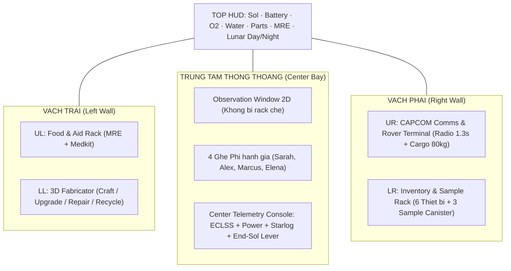
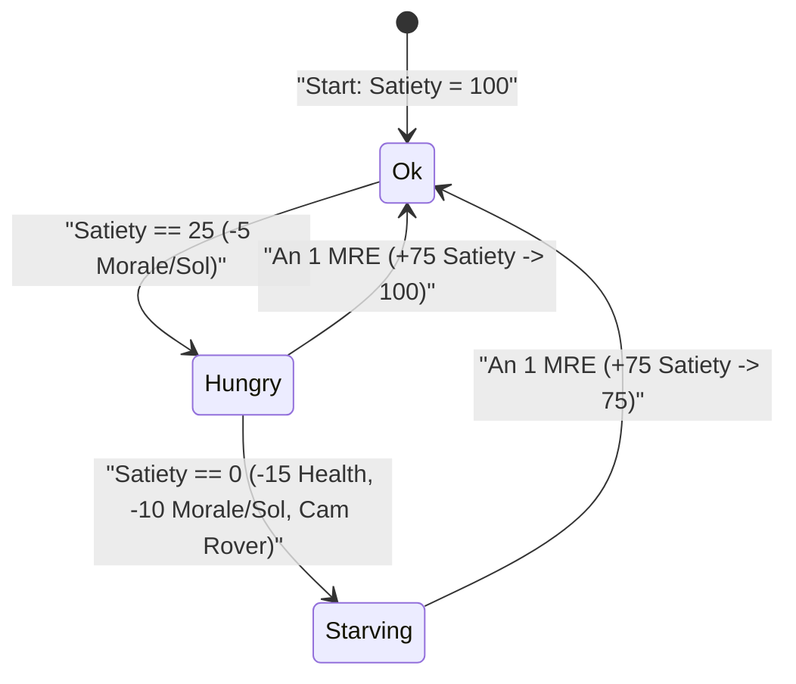
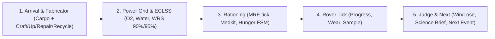
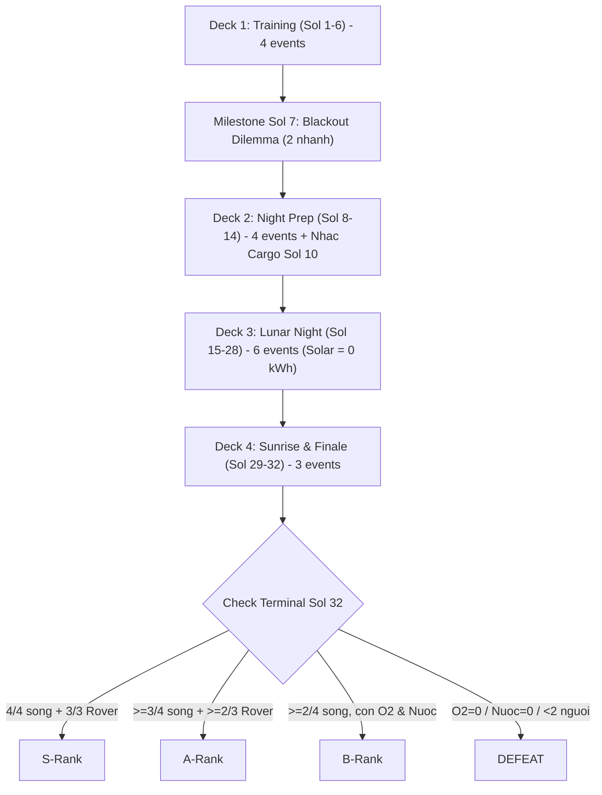

# PHASE 1 — Đặc tả Gameplay KISS & Cockpit Vách cho *Human Frontier 2050+* (`Moon 32 Sol`)

> **Trạng thái đã chốt cùng Chủ dự án:**
> - **Cân bằng & WRS:** Phương án A (`WRS 90% / 95%`, Golden Sol 7: `25.0 L` vs `34.0 L`).
> - **Phi hành đoàn:** KISS `2` thanh (`Health`, `Morale`) + `1 Role Tag` + FSM đói `Ok → Hungry → Starving`.
> - **Kho đồ & Chế tạo kiểu *60 Parsecs!*:** Không thêm `Chemicals`; chốt `2` Consumables (`MRE`, `Medkit`) + `6` Equipment có độ bền (`Good / Worn / Damaged`) và **3D Fabricator** (`Craft / Upgrade / Repair / Recycle`).
> - **Bố cục Cockpit Mới:** Gỡ 3 cục máy treo tường (`Oxygen`, `Water`, `Power`) đưa vào màn hình **Telemetry Console**; dời **2 Rack ra 2 vách trái/phải** cùng **3D Fabricator** & **CAPCOM Comms** để giải phóng toàn bộ khung trung tâm cho **Observation Window** và **4 ghế phi hành gia**.

---

## 1. Bố cục Cockpit Mới (2 Rack trên 2 Vách + Trung tâm Thông thoáng)

### Bảng Chuyển đổi Vị trí từ V12 sang Bố cục Vách Mới (`1672×941`)

| Vị trí Cockpit | Nội dung Mới (Đã chốt) | Thay đổi so với V12 cũ | Hành động mở Modal |
| :--- | :--- | :--- | :--- |
| **Góc Trên-Trái (`UL`)** | **`Food & Aid Rack`** (`MRE` + `Medkit`) | Thay thế `Oxygen Generator`; dời từ giữa sang vách trái | Mở **Rationing & Medical** |
| **Góc Dưới-Trái (`LL`)** | **`3D Fabricator`** (`IDLE / WORKING / DAMAGED`) | Thay thế `Water Recycler` (tái dùng `fabricator_3d_idle.png`) | Mở **3D Fabricator (Craft/Up/Repair/Recycle)** |
| **Góc Trên-Phải (`UR`)** | **`CAPCOM & Rover Comms`** | Giữ nguyên vị trí `UR` V12 (`PH_EQP_COMMS_TERMINAL_BASE_V12`) | Mở **Comms, Cargo `80 kg` & Rover** |
| **Góc Dưới-Phải (`LR`)** | **`Inventory & Sample Rack`** (`6` Equipment + `3` Sample) | Thay thế `Power Module`; dời từ giữa sang vách phải | Mở **Inventory & Chọn đồ Rover** |
| **Trung tâm (`Center`)** | **`Observation Window` + `4 Ghế` + `Telemetry Console`** | Thông thoáng 100% không bị 2 rack che cửa sổ & hàng ghế sau | Click **Console** mở **ECLSS/Power Telemetry & Starlog** |

*(Ghi chú Visual Assets: Gỡ `PH_EQP_OXYGEN_GENERATOR_*`, `PH_EQP_WATER_RECYCLER_*`, `PH_EQP_POWER_MODULE_*` khỏi render vách; tái sử dụng 2 Rack V12 gắn lên 2 vách, bổ sung asset `3D Fabricator` chuẩn AeroMatte 2050 từ mẫu `fabricator_3d_idle.png`.)*

---

## 2. Tài nguyên & Kho hiển thị (`4 Kho Chính` — Không thêm `Chemicals`)

Engine tự xử lý ngầm `wasteWaterL` nội bộ cho WRS. Mọi thao tác chế tạo chỉ dùng **`Parts` + `Battery (kWh)` (+ `Water` cho `MRE`)**.

| Tài nguyên / Vật tư | Đơn vị | Khởi đầu `Sol 1` | Giới hạn kho | Định mức tự động / Ghi chú NASA |
| :--- | :--- | :---: | :---: | :--- |
| **Pin (`Battery`)** | `kWh` | `40` | `60` | Fission: `+8 kWh/Sol` · Solar: `+24 kWh/Sol` (Lv1), `0` vào Đêm Trăng `Sol 15–28` · Tải nền trạm: `12 kWh/Sol`. |
| **Oxy (`O₂`)** | `kg` | `70` | `120` | Tự động trừ **`0.85 kg/người/Sol`** (`3.4 kg/Sol` cho 4 người). |
| **Nước sạch (`Water`)** | `L` | `80` | `160` | Tự động trừ **`2.5 L/người/Sol`** (`10.0 L/Sol` cho 4 người); WRS thu hồi **`90%`** (Lv1) hoặc **`95%`** (Lv2/Lv3). |
| **Phụ tùng (`Parts`)** | `kg` | `16` | `60` | Sửa hệ thống: `2 kg` · Nâng cấp hệ thống Lv2/Lv3: `4 / 8 kg` · Nguyên liệu in 3D cho `3D Fabricator`. |
| **Gói ăn (`MRE` — `UL Rack`)** | `gói` | `24` | `60` | `1 MRE ≈ 0.62 kg`, dùng dạng tick phát cho từng người ở bước Rationing. |
| **Túi y tế (`Medkit` — `UL Rack`)** | `liều` | `2` | `6` | Chữa khỏi `Injured` và hồi `+30 Health` (`Lv2: +50 Health`; `Marcus` cầm +20 thêm). |

### Bộ bậc số chuẩn cho mọi Sự kiện (`Event Presets`)
- **Nhân sự (`Health / Morale / Satiety`):** `TINY = 5` · `SMALL = 10` · `MEDIUM = 20` · `LARGE = 30`.
- **Vật tư:** `Pin (±8 / ±16 / ±24 kWh)` · `Nước (±10 / ±20 L)` · `O₂ (±5 / ±10 / ±15 kg)` · `Phụ tùng (±2 / ±4 kg)` · `MRE (±2 / ±4 gói)`.

---

## 3. Phi hành đoàn: `2 Thanh + 1 Vai trò + FSM Đói (Ok / Hungry / Starving)`

### 3.1. Hồ sơ 4 Nhà khoa học (`Role Tag`)
| Nhân vật | Vai trò (`Role`) | Khả năng đặc biệt |
| :--- | :--- | :--- |
| **Sarah Chen** (`cmd`) | `Commander` | Miễn nhiễm tụt `Morale` khi trực xử lý khủng hoảng / CAPCOM. |
| **Alex Rivera** (`eng`) | `Engineer` | Sửa hệ thống về `100%`, giảm `1 kg Parts` khi nâng cấp hệ thống trên Console (`solar / recycler / scrubber / airlock`, tối thiểu `1 kg`). |
| **Marcus Vance** (`doc`) | `Medic` | Dùng `Medkit` hồi thêm `+20 Health`; trực `medical-care` hồi `+15 Morale` cho đồng đội. |
| **Elena Rostova** (`geo`) | `Geologist` | Trực Rover tăng hiệu quả khai thác và giảm `50%` hao mòn độ bền thiết bị gắn theo Rover. |

### 3.2. Chỉ số & Máy trạng thái (`FSM`)
1. **`Health` (`0–100`, khởi đầu `80`):** `< 50` → **`Injured`** (hồi khi `>= 65` hoặc dùng `Medkit`; cấm sửa nặng & trực Rover); `<= 0` → **`Evacuated`**.
2. **`Morale` (`0–100`, khởi đầu `80`):** `< 30` → **`Tired`** (hồi khi `>= 45`; cấm trực Rover & xử lý khẩn cấp; chọn `Rest` hồi `+30 Morale`).
3. **FSM Đói (`Satiety` `0–100`, khởi đầu `100` — Giảm `-25 / Sol`):**

---

## 4. Hệ thống Tàu (`Console Telemetry`) & `3D Fabricator` (`8` Món Kho đồ)

### 4.1. 5 Hệ thống kỹ thuật (`maxLevel = 3`)
4 hệ thống hạ tầng hiển thị & thao tác trong **Telemetry Console** (`solar`, `recycler`, `scrubber`, `airlock`) + **`fabricator`** đứng tại vách Dưới-Trái (`LL`):

| Hệ thống (`id`) | Cấp 1 (`Mặc định`) | Cấp 2 (`4 Parts`) | Cấp 3 (`8 Parts`) | Sửa (`2 Parts`) |
| :--- | :--- | :--- | :--- | :--- |
| **`solar`** | `24 kWh/Sol` (ban ngày) | `30 kWh/Sol` | `36 kWh/Sol` | `integrity -> 1.0` |
| **`recycler`** (WRS) | Thu hồi **`90%`** (`4 kWh`, max `20 L/lần`) | Thu hồi **`95%`** (`4 kWh`) | Thu hồi **`95%`** (`3 kWh`) | `integrity -> 1.0` |
| **`scrubber`** | Lọc CO₂ chuẩn | Giảm rủi ro bão bụi | Chắn 100% bão hạt/bụi | `integrity -> 1.0` |
| **`airlock`** | Chuẩn (`<1.0` rò `-1 kg O₂/Sol`) | Chịu mài mòn regolith | Chống co ngót lạnh `-173°C` | `integrity -> 1.0` |
| **`fabricator`** (`LL`) | Mở công thức đồ **Lv1** | Mở công thức đồ **Lv2** | Mở công thức đồ **Lv3** | `integrity -> 1.0` |

### 4.2. Kệ đồ & Bảng Chế tạo (`2 Consumables + 6 Equipment`)
`3D Fabricator` vận hành **tự động (0 slot Crew)** — chỉ tốn `Parts + Battery (+ Water nếu chế MRE)`. Mỗi Sol chạy **tối đa `1` lệnh trên `3D Fabricator`** (`Craft`, `Upgrade`, `Repair` hoặc `Recycle`), hoàn tất sau thời gian quy định (`1d` = cuối Sol đó, `2d` = cuối Sol kế tiếp):

#### A. Nhóm Tiêu hao (`UL — Food & Aid Rack`)
| Món | Cấp Xưởng | Craft | Upgrade Lv2 | Recycle | Tác dụng |
| :--- | :---: | :--- | :--- | :--- | :--- |
| **`MRE Pack`** | Lv1 | `2 Parts + 2 L Water + 4 kWh` (`1d`) | — | `1 Parts` (`1d`) | `+75 Satiety` (`Ok`) cho 1 người |
| **`Medkit`** | Lv1 | `3 Parts + 4 kWh` (`2d`) | `4 Parts + 4 kWh` (`1d`) | `2 Parts` (`1d`) | Xóa `Injured`, hồi `+30 Health` (`Lv2: +50`) |

#### B. Nhóm Thiết bị (`LR — Inventory & Sample Rack`, tối đa `6` loại)
- **Độ bền 3 bậc:** `Good (100%)` → `Worn (50%)` → `Damaged (0%, không dùng được)`.
- **Sửa chữa (`Repair`):** Tốn **`2 Parts + 2 kWh`** (`1d`) phục hồi `Damaged/Worn` → `Good`.
- **Tái chế (`Recycle`):** Phá `1` thiết bị nhận lại **`50% Parts`** làm tròn lên (`1d`).
- **Đầu game `Sol 1` có sẵn:** `Core Drill` (`Good`) + `Sealant Tape` (`Good`).

| Thiết bị (`Equipment`) | Cấp Xưởng | Craft | Upgrade Lv2 | Vai trò `BlockThreat` Rover & Sự kiện |
| :--- | :---: | :--- | :--- | :--- |
| **1. `Core Drill`** | Lv1 | `4 Parts + 4 kWh` (`1d`) | Bền gấp đôi (`-25%/chuyến`) | Chặn rủi ro **Địa hình dốc (`Lunar Crater`)** & đào mẫu |
| **2. `Sealant Tape`** | Lv1 | `2 Parts + 2 kWh` (`1d`) | Dùng `2` lần trong Event | Bịt rò `Airlock` / sửa nhanh trong Event không tốn `Parts` |
| **3. `Dust Shield`** | Lv2 | `4 Parts + 4 kWh` (`1d`) | Miễn hao mòn bão bụi | Chặn hiểm họa **Bụi tĩnh điện (`Regolith Field`)** |
| **4. `Radio Repeater`** | Lv2 | `4 Parts + 6 kWh` (`1d`) | Giảm 50% chi phí cứu Sol 7 | Hỗ trợ sóng Rover (`Regolith Field` / `Sol 7`) & CAPCOM |
| **5. `Cryo Thermal Rig`** | Lv3 | `6 Parts + 6 kWh` (`1d`) | Không tụt Pin phụ trong PSR | Chặn hiểm họa **Lạnh `-173°C` (`PSR`)** & sự kiện Đêm Trăng |
| **6. `Solar Lantern`** | Lv1 | `3 Parts + 3 kWh` (`1d`) | +10 Morale trong Đêm Trăng | Chiếu sáng vùng tối (`PSR`) & chống giảm Morale Đêm Trăng |

---

## 5. Cargo Tiếp tế (`80 kg = 4 Slot × 20 kg`) & Rover `BlockThreat`

### 5.1. Cargo từ Trái Đất (`UR — CAPCOM Comms`, bay `4 Sol`, hồi `1 Sol`)
Cargo **chỉ cung cấp nguyên liệu & vật tư sinh tồn** (không gửi sẵn thiết bị in 3D):
- **Gói Oxy (`20 kg`):** `+20 kg O₂`.
- **Gói Nước (`20 kg`):** `+25 L Water`.
- **Gói Thực phẩm & Y tế (`20 kg`):** `+10 MRE` + `1 liều Medkit`.
- **Gói Pin & Phụ tùng (`20 kg`):** `+25 kWh Pin` + `+6 kg Parts`.

### 5.2. Rover Expedition (`3 Sol` cố định, phóng tốn `4 kWh`, gắn tối đa `3` Thiết bị từ `LR Rack`)

| Chuyến (`Cửa sổ`) | Địa điểm | Hiểm họa (`Threat`) | Điều kiện `BlockThreat` An toàn `100%` | Thưởng (`LR Sample` + Vật tư) |
| :--- | :--- | :--- | :--- | :--- |
| **1 (`Sol 1–4`)** | `Lunar Crater` | Địa hình dốc | Mang **`Core Drill`** (hoặc `Elena` trực) | `Sample #1` + `+20 Science` |
| **2 (`Sol 5–8`)** | `Regolith Field` | Bụi tĩnh điện + Mất sóng Sol 7 | Mang **`Dust Shield`** hoặc **`Radio Repeater`** | `Sample #2` + `+4 Parts` |
| **3 (`Sol 9–12`)** | `PSR (Vùng tối)` | Nhiệt độ cực lạnh `-173°C` | Mang **`Cryo Thermal Rig`** (hoặc `Solar Lantern` + Pin `>= 20 kWh`) | `Sample #3` + **`+20 L Nước`** |

*(Mỗi thiết bị tham gia chuyến đi sẽ giảm `50%` độ bền: `Good → Worn → Damaged`; nếu `Elena` trực giảm còn `-25%` hoặc miễn giảm lần đầu khi đồ đã nâng cấp Lv2.)*

---

## 6. Vòng lặp End-Sol 5 Bước & Golden Scenario Sol 7 (Phương án A)

- **Golden Scenario Sol 7 (`WRS Lv1 = 90%`, fixture `35.0 L` nước sạch, `10.0 L` nước thải, `8 kWh` phát + `8 kWh` pin):**
  - **Nhánh A — Cứu Rover (`emergency-response` tốn `2 kWh`, tắt WRS):** Còn **`25.0 L` nước, `2.0 kWh` pin**; Expedition 2 hoàn thành vào Sol 8.
  - **Nhánh B — Ưu tiên Trạm (`WRS ON` tốn `4 kWh`):** Thu hồi `10 × 90% = +9.0 L` → Còn **`34.0 L` nước, `0.0 kWh` pin**; Expedition 2 hết hạn thất bại, Rover vẫn nguyên vẹn cho Expedition 3.

---

## 7. Nhịp Điều phối Sự kiện (`Pacing Decks`) & Thắng/Thua Sol 32

