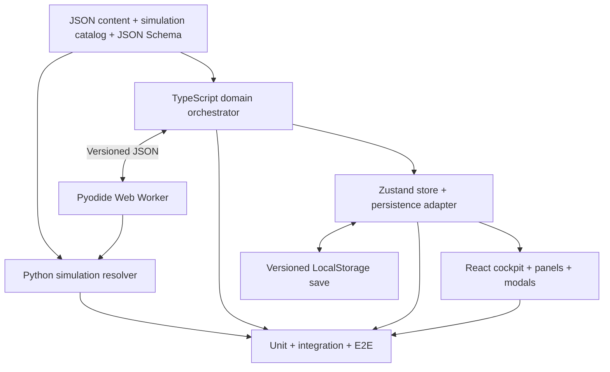

# PHASE 1 — Kế hoạch hoàn chỉnh Moon Survival 32 Sol từ project trắng

> **Mục tiêu:** xây dựng từ repository trống thành campaign Mặt Trăng độc lập hoàn chỉnh, chơi từ Sol 1 đến hết Sol 32, bao gồm 14 Sol Lunar Night và màn tổng kết thắng/thua.
>
> **Phạm vi tài liệu:** toàn bộ product, game design, code, data, UI/UX, asset, nội dung STEM, kiểm thử và phát hành cần thiết cho PHASE 1. Không giả định bất kỳ code hay asset nào đã tồn tại.
>
> Cách xử lý conflict với các handoff V12/Decision Tree/Award Roadmap được khóa tại [`PHASE_1_DOCUMENT_RECONCILIATION.md`](PHASE_1_DOCUMENT_RECONCILIATION.md).

## 1. Kết quả cuối Phase 1

Người chơi phải có thể:

1. Mở game, xem intro ngắn và bắt đầu chiến dịch Mặt Trăng.
2. Hoàn thành Moon Training 12 Sol, chuẩn bị Lunar Night ở Sol 13–14, sống qua đêm Sol 15–28 và phục hồi đến Sol 32.
3. Đọc briefing và xử lý sự kiện mỗi sáng.
4. Phân công tối đa một nhiệm vụ cho mỗi thành viên trong một Sol.
5. Sửa chữa/nâng cấp hệ thống và cân bằng điện, oxy, nước, thực phẩm, phụ tùng.
6. Lập kế hoạch, phóng và theo dõi ba chuyến rover.
7. Gửi radio cho Houston và yêu cầu tiếp tế có độ trễ/thời gian vận chuyển.
8. Chốt khẩu phần, chạy mô phỏng cuối Sol và hiểu hệ quả.
9. Đọc NASA Science Brief gắn với chính sự kiện/số liệu vừa xảy ra.
10. Đi đến Moon Victory/Game Over và NASA Cadet Report Card có tổng kết 32 Sol.
11. Tắt trình duyệt, mở lại và tiếp tục đúng save gần nhất.

### Điều kiện thắng cuối campaign

- Hoàn thành End-Sol 32.
- Còn crew hoạt động và trạm duy trì được life support theo `moon32.victoryRequirements`.
- Thành tích 4/4 crew và 2/3 hoặc 3/3 expedition quyết định rank/Report Card.

### Điều kiện thua chuẩn

- Toàn bộ crew bị evacuated hoặc trạm mất khả năng duy trì sự sống theo terminal rule.
- Không còn phương án hợp lệ để đạt điều kiện chuyển tiếp/victory.
- Không còn khả năng phục hồi trước terminal threshold của Moon campaign.

Các điều kiện này phải được mã hóa trong engine và kiểm thử tự động, không chỉ hiển thị ở UI.

## 2. Phạm vi khóa của PHASE 1

### Bắt buộc có

- Một campaign Moon Survival 32 Sol độc lập.
- Một cockpit 2D/2.5D responsive.
- Bốn phi hành gia.
- Bốn hệ thống: `scrubber`, `recycler`, `solar`, `airlock`.
- Sáu kho tài nguyên: oxy, nước sạch, nước thải, thực phẩm, phụ tùng, pin.
- Năm bước gameplay: briefing, engineering, comms/logistics, rationing, end-Sol debrief.
- Crew assignment “một người, một việc, một Sol”.
- Ba chuyến rover và ba địa điểm khảo sát.
- Sự cố bắt buộc Sol 7 với hai nhánh đánh đổi.
- Event ngẫu nhiên có seed và điều kiện.
- Radio Mặt Trăng và tiếp tế.
- Save/load, tutorial ngắn, thắng/thua, chơi lại.
- NASA Science Brief có nguồn và phân loại dữ liệu.
- Resource Predictor dùng cùng resolver với End-Sol và biểu đồ xu hướng 5 Sol.
- Cockpit V12 gồm 6 module, 2 rack tương tác và Observation Window Mặt Trăng.
- Critical path song ngữ VI/EN, Mission Seed và NASA Cadet Report Card.
- Desktop hoàn chỉnh và mobile dùng được.

### Không làm trong PHASE 1

- Campaign Mars độc lập và chế độ Moon→Mars hai chặng.
- Nội dung sau Moon Victory Sol 32.
- NASA DONKI live API; Phase 1 dùng dataset/brief đã tuyển chọn và đóng gói offline.
- Minigame 3D thu gom đồ.
- EVA điều khiển trực tiếp, multiplayer, backend/account, leaderboard.
- Nhà kính, chế tạo phức tạp, skill tree hoặc inventory drag-and-drop.
- Voice-over, cinematic dài và bản địa hóa ngoài VI/EN.

## 3. Trải nghiệm mục tiêu

### Moon Training Track 12 Sol trong campaign 32 Sol

| Chặng | Sol | Nội dung chính |
| --- | --- | --- |
| Làm quen | 1–2 | Tutorial, đọc telemetry, phân công, chốt Sol đầu tiên |
| Vận hành cơ bản | 1–4 | Chuyến rover 1; sự kiện nhẹ về ECLSS/regolith |
| Áp lực hệ thống | 5–8 | Chuyến rover 2; rò khí + thiếu điện + mất tín hiệu ở Sol 7 |
| Kiểm tra tổng hợp | 9–12 | Chuyến rover 3; Moon Training Report |
| Chuẩn bị đêm | 13–14 | Cargo, repair, upgrade và tích pin |
| Lunar Night | 15–28 | Solar 0 kWh; sống bằng fission, battery và rationing |
| Phục hồi | 29–31 | Nắng trở lại; khôi phục trạm và crew |
| Chung kết | 32 | Moon Victory/Defeat và Report Card |

### Ba chuyến rover

| Mission | Cửa sổ | Địa điểm | Bài học |
| --- | --- | --- | --- |
| Expedition 1 | Sol 1–4 | Lunar Crater | Địa chất va chạm và lấy mẫu |
| Expedition 2 | Sol 5–8 | Regolith Field | Bụi tĩnh điện, hao mòn và liên lạc |
| Expedition 3 | Sol 9–12 | Permanently Shadowed Region | Băng nước, nhiệt độ cực thấp và năng lượng |

Mỗi chuyến cần tối thiểu: mục tiêu, thời lượng, chi phí điện, dụng cụ, người trực lúc phóng/thu hồi, trạng thái, tiến độ, rủi ro, phần thưởng khoa học và log kết quả.

### Sự cố trọng tâm Sol 7

State đầu vào của scenario kiểm chứng phải được cố định bằng fixture:

- 35 L nước sạch, 10 L nước thải, 8 kWh nguồn trong Sol và 8 kWh pin.
- Tải thiết yếu 12 kWh; WRS cần 4 kWh; thu hồi 93% tối đa 10 L.
- Ba người đã bận xử lý rò khí, kiểm tra nguồn điện và cô lập mạch lỗi.
- Elena là người duy nhất còn có thể nhận việc.

Hai lựa chọn bắt buộc:

- **Cứu rover:** tốn 2 kWh, hoãn WRS, chuyến 2 có thể hoàn thành; cuối Sol mục tiêu là 25.0 L nước và 2 kWh pin.
- **Ưu tiên trạm:** chạy WRS, bỏ hạn cứu dữ liệu rover; cuối Sol mục tiêu là 34.3 L nước và 0 kWh pin; chuyến 2 thất bại nhưng rover còn dùng được cho chuyến 3.

Đây là acceptance scenario quan trọng nhất của PHASE 1 và phải có golden test.

## 4. Kiến trúc cần dựng



### Nguyên tắc bắt buộc

- Python simulation chạy trong persistent Pyodide Web Worker; không chạy trên main thread.
- TypeScript quản lý phase/plan/store nhưng không chứa công thức End-Sol hoặc forecast thứ hai.
- Worker/resolver không truy cập React, DOM, Zustand hoặc LocalStorage.
- Cùng `state (có committed plan) + seed + modelVersion + catalogVersion` phải cho cùng canonical response/hash.
- UI không chứa công thức cân bằng hoặc tự sửa state.
- Mọi event, mission, brief và thông số balance phải nằm trong data.
- Command sai phase hoặc không hợp lệ trả về lỗi domain có mã và giải thích; UI dùng lỗi đó để phản hồi cho trẻ, không im lặng.
- Save có `schemaVersion`, `modelVersion`, `catalogVersion` và migration/compatibility check từ ngày đầu.
- Mỗi số liệu STEM phải được đánh dấu là `observed`, `inferred` hoặc `simulated`.
- Worker lỗi, response stale hoặc version mismatch phải giữ nguyên state và cho phép retry.

State và JSON worker contract chi tiết được khóa tại [`PHASE_1_1_STATE_CONTRACT.md`](PHASE_1_1_STATE_CONTRACT.md).

## 5. Cấu trúc repository đề xuất

```text
project-hail/
├── .github/
│   ├── workflows/ci.yml
│   └── pull_request_template.md
├── docs/
│   ├── product/
│   ├── architecture/
│   ├── game-design/
│   ├── ui-ux/
│   └── asset-pipeline/
├── public/
│   ├── assets/hail/
│   ├── pyodide/             # self-host để offline/cache
│   └── python/hail_sim/     # Python runtime resolver package
├── src/
│   ├── app/                 # bootstrap, providers, routes/error boundary
│   ├── components/          # common UI primitives
│   ├── features/
│   │   ├── briefing/
│   │   ├── engineering/
│   │   ├── crew/
│   │   ├── comms/
│   │   ├── rover/
│   │   ├── rationing/
│   │   └── debrief/
│   ├── domain/              # TypeScript phase/plan orchestration
│   │   ├── commands/
│   │   ├── selectors/
│   │   └── validation/
│   ├── simulation/          # Worker client + JSON contract
│   │   ├── simulation.worker.ts
│   │   ├── workerClient.ts
│   │   └── contracts/
│   ├── data/
│   │   ├── balance.json
│   │   ├── crew.json
│   │   ├── events.json
│   │   ├── expeditions.json
│   │   ├── initial-state.json
│   │   ├── simulation-catalog.json
│   │   └── science-briefs.json
│   ├── schemas/
│   ├── store/
│   ├── types/
│   ├── utils/
│   └── styles/
├── tests/
│   ├── domain/
│   ├── simulation/
│   ├── fixtures/
│   ├── integration/
│   └── e2e/
├── package.json
├── tsconfig.json
└── vite.config.ts
```

## 6. Domain model tối thiểu

Trước khi làm UI, phải khóa type/schema cho các entity sau:

| Entity | Field quan trọng |
| --- | --- |
| `GameState` | versions, revision, campaign, clock, resources, systems, crew, dailyPlan, rover, events, logistics, debrief, history |
| `CrewMemberState` | id, health, stress, fatigue, hunger, thirst, radiationMgy, condition, illness, lastResolvedSol |
| `StationSystemState` | id, level, integrity, status, operatingState, ageSols, lastResolvedSol |
| `ResourceState` | oxygenKg, waterCleanL, waterGreyL, foodKg, partsKg, batteryKwh |
| `DailyPlan` | status, sol, ration, systemModes, powerPriority, WRS request, assignments, roverAction |
| `RoverMission` | id, site, startSol, duration, status, progress, crew slots, power cost, equipment, result |
| `GameEvent` | id, trigger, choices, requirements, outcomes, scienceBriefId |
| `RadioMessage` | id, sentAt, receiveAt, replyAt, status, content |
| `CargoMission` | id, requestedAtSol, arrivalSol, payload, status |
| `ScienceBrief` | id, title, childFriendlyText, sourceTitle, sourceUrl, evidenceType, relatedMetrics |
| `SaveGame` | schemaVersion, savedAt, contentVersion, state |
| `CampaignDefinition` | id, targetSol, requiredLivingCrew, requiredCompletedExpeditions, difficultyProfile |
| `InventoryState` | MRE/food display, medkit charges, sample canisters, reserved core drill |

### Command tối thiểu

- `start-campaign`
- `acknowledge-briefing`
- `choose-event-option`
- `assign-crew` / `unassign-crew`
- `repair-system` / `upgrade-system`
- `schedule-expedition` / `confirm-expedition`
- `transmit-radio` / `request-resupply`
- `set-ration-plan` / `set-power-priority`
- `advance-phase`
- `end-sol`
- `dismiss-debrief`
- `restart-campaign`

## 7. Engine và luật mô phỏng cần làm

### State machine

```text
title → briefing → engineering → comms → rationing → resolving
          ▲                                           │
          └──────────── debrief ←─────────────────────┘

debrief → briefing của Sol kế tiếp
debrief → victory | defeat khi có terminal condition
```

Mỗi phase phải có guard rõ ràng và selector `canAdvancePhase` trả cả boolean lẫn lý do.

### End-Sol resolver

Thứ tự xử lý phải cố định:

1. Khóa daily plan và assignments.
2. Phát điện từ fission + solar; tính pin nạp/xả.
3. Cấp điện theo thứ tự ưu tiên đã chọn.
4. Chạy recycler và cập nhật nước sạch/nước thải.
5. Tính oxy tiêu thụ, năng lực scrubber và rò airlock.
6. Tính nước/thực phẩm được phân phối.
7. Tiến triển rover, xử lý deadline và rủi ro.
8. Áp kết quả công việc/sự kiện và hao mòn hệ thống.
9. Cập nhật chỉ số từng thành viên.
10. Nhận cargo đến hạn.
11. Kiểm tra thắng/thua.
12. Sinh log, delta và brief cho debrief.
13. Nếu tiếp tục, tăng Sol và chuẩn bị briefing mới.

### Công thức baseline

| Thông số | Baseline |
| --- | ---: |
| Oxy | 0.84 kg/người/Sol |
| Nước | 2.5 L/người/Sol |
| Thực phẩm | 0.62 kg/người/Sol |
| Tải thiết yếu | 12 kWh/Sol |
| Fission | 8 kWh/Sol |
| Solar cấp 1 | 25 kWh/Sol |
| Pin tối đa | 60 kWh |
| Recycler | 4 kWh/chu kỳ |
| Hiệu suất WRS | 85% / 90% / 93% |
| Sửa chữa | 2 kg phụ tùng |
| Nâng cấp | 4 kg lên cấp 2; 8 kg lên cấp 3 |
| Radio một chiều | 1.3 giây |
| Cargo | 4 Sol, tối đa 80 kg |

Tất cả con số phải nằm trong `balance.json`, có đơn vị và chú thích nguồn/ý nghĩa gameplay.

## 8. Nội dung cần sản xuất

### Event catalog tối thiểu

PHASE 1 cần đủ nội dung để cả hai arc không lặp nhàm chán:

- 3 event hướng dẫn có kiểm soát ở Sol 1–3.
- 6–8 event ngẫu nhiên có điều kiện.
- 3 event môi trường Mặt Trăng: solar particles, regolith, thermal/shadow.
- 3 event hệ thống: rò airlock, giảm hiệu suất recycler, lỗi solar/scrubber.
- 2 event crew: stress/fatigue hoặc chấn thương nhẹ.
- 1 chuỗi event bắt buộc Sol 7.
- 1 event kết thúc cho từng outcome thắng/thua.

Mục tiêu release là **18–24 event Moon** có phân nhánh, gồm rover training, Sol 7, chuẩn bị đêm, Lunar Night và phục hồi.

Mỗi event cần title, prompt, hình, điều kiện, lựa chọn, chi phí thấy trước, outcome, effect, log và Science Brief liên kết.

### Science Brief tối thiểu

- ECLSS và nhu cầu oxy.
- Tái chế nước trên trạm.
- Bụi regolith.
- Bức xạ/bão hạt Mặt Trời.
- Fission + solar ở cực Nam Mặt Trăng.
- Độ trễ radio Trái Đất–Mặt Trăng.
- Băng nước trong PSR.
- Robot khảo sát và giới hạn liên lạc.

Mỗi brief cần URL nguồn NASA cụ thể, ngày truy cập và phần “đây là dữ liệu thật” / “đây là mô phỏng game”.

### Viết nội dung cho trẻ 7–12 tuổi

- Một câu không quá dài và chỉ đưa một ý chính.
- Thuật ngữ có giải thích ngay lần đầu.
- Nút dùng động từ rõ: “Thay gioăng”, “Tắt WRS để cứu rover”.
- Hiển thị trước chi phí và hậu quả có thể dự đoán.
- Không dùng thông báo lỗi kỹ thuật như “invalid action”.

## 9. UI/UX cần làm

### Các màn hình

1. Loading/boot và kiểm tra save.
2. Title screen: New Mission, Continue, How to Play, Credits.
3. Intro/tutorial.
4. Cockpit chính.
5. Starlog/Morning Briefing.
6. Crew assignment.
7. Engineering/system control.
8. Rover expedition planner.
9. Comms & logistics.
10. Rationing/power plan.
11. End-Sol confirmation.
12. Night transition/debrief + Science Brief.
13. Victory summary.
14. Defeat summary.
15. Settings: âm lượng cơ bản, reduced motion, reset save.
16. Language switch VI/EN và NASA Cadet Report Card.

### Cockpit phải thể hiện

- Sol hiện tại và phase hiện tại.
- Sáu tài nguyên cùng xu hướng dự kiến cuối Sol.
- Bốn nhân vật và trạng thái/assignment.
- Bốn hệ thống với level, integrity, power, cảnh báo.
- Rover status và deadline.
- Event chưa xử lý.
- Nút tiến phase/chốt Sol luôn kèm lý do nếu bị khóa.
- `targetSol: 32` và các mốc 12/15/29 lấy từ campaign config, không hardcode trong component.
- Hai rack V12 phản chiếu MRE, First Aid, Sample Canister và Core Drill từ domain state.

### Trạng thái UI bắt buộc

- Loading, empty, ready, selected, disabled-with-reason, warning, critical, success, failure.
- Hệ thống: `ok`, `degraded`, `broken`, `unpowered`, `under-repair`.
- Crew: `available`, `busy`, `tired`, `injured`, `incapacitated`, `deceased`.
- Rover: `idle`, `scheduled`, `outbound`, `exploring`, `signal-lost`, `returning`, `completed`, `failed`.

### Accessibility và responsive

- Chơi được bằng bàn phím; focus trap/restore đúng cho modal.
- Không dùng màu là tín hiệu duy nhất.
- Text và control đạt WCAG AA; target cảm ứng tối thiểu 44×44 px.
- Có `prefers-reduced-motion` và nút bỏ qua typewriter/cutscene.
- Screen reader đọc được resource delta, cảnh báo và kết quả Sol.
- Desktop thiết kế theo 16:9; mobile chuyển thành dashboard theo tab thay vì thu nhỏ toàn bộ cockpit.

## 10. Asset cần sản xuất

### Environment

- Space background.
- Cockpit shell/base cabin.
- Cảnh ngoài cửa sổ Mặt Trăng: daylight, low-light/shadow, warning/radiation.
- Lunar map và ba khu vực rover.
- Observation Window Canvas 2D thể hiện Moon day, sunset, Lunar Night và sunrise/recovery.

### Character

- Bốn portrait.
- Bốn nhân vật ngồi trong cabin.
- Tối thiểu ba biểu cảm/trạng thái mỗi người: normal, stressed/tired, injured/critical.

### Equipment và state variants

- Scrubber, recycler, solar/power module, airlock, comms, rover station, medical, console.
- Mỗi hệ thống trọng tâm có `base`, `degraded`, `broken`; trạng thái mất điện có thể dùng overlay chung.

### UI/icon

- Sáu icon tài nguyên.
- Bốn icon hệ thống.
- Icon trạng thái, action, navigation, NASA STEM badge.
- Frame, warning overlay, focus/selection effect.

### Event và rover

- Ảnh cho toàn bộ event bắt buộc và event thường dùng.
- Rover `idle`, `active`, `signal-lost/broken`.
- Ba preview địa điểm và các sample/reward chính.

### Chuẩn asset

- Raster dùng WebP, icon/frame ưu tiên SVG.
- Tên file có namespace, loại, đối tượng, state, version.
- Có manifest ghi kích thước, anchor, layer, nguồn và license.
- Không dùng asset, audio hoặc trademark lấy từ game thương mại tham chiếu.
- Có budget dung lượng và lazy-load ảnh modal/event.

## 11. Âm thanh tối thiểu

- Ambient loop cabin nhẹ.
- Click/confirm/cancel.
- Warning và critical alarm không gây khó chịu cho trẻ.
- Radio send/receive.
- Rover launch/return.
- End-Sol transition, victory và defeat sting.
- Có mute, volume và không autoplay trái chính sách trình duyệt.

Âm thanh là hạng mục “should-have”: có thể dùng Web Audio/SFX đơn giản, nhưng title/settings vẫn phải xử lý trạng thái không có audio một cách hoàn chỉnh.

## 12. Save, telemetry và lỗi

### Save/load

- Auto-save sau mỗi command đã commit và sau End-Sol.
- Một save campaign, có timestamp và Sol/phase preview.
- Validate dữ liệu khi load; save lỗi phải có lựa chọn bỏ qua/xóa, không làm trắng màn hình.
- Reset save cần xác nhận hai bước.
- Có export/import JSON ở development build để debug scenario.

### Error handling

- React error boundary và fallback screen.
- Asset lỗi có placeholder.
- Nội dung JSON sai schema làm CI fail.
- Không có network vẫn chơi được toàn bộ campaign.
- Log phát triển không chứa dữ liệu cá nhân; Phase 1 không cần analytics người dùng.

## 13. Kế hoạch kiểm thử

### Unit test engine

- Mọi phase transition và guard.
- Crew assignment độc quyền.
- Điện generation/load/battery và power priority.
- Oxy, nước, food, recycler, leak và clamp không âm/vượt capacity.
- Repair/upgrade và chi phí.
- Seeded RNG tái lập được.
- Event condition/effect và event không lặp sai.
- Rover schedule/progress/deadline/result.
- Radio và cargo timing.
- Victory/defeat.
- Save migration/validation.

### Golden scenario

- Chạy Moon Training đến Sol 12 cho cả hai nhánh Sol 7.
- Chạy full trace Moon 32 Victory cho từng difficulty profile chính.
- Xác nhận đúng các mốc nước, pin và số mission theo đặc tả Sol 7.
- Replay cùng seed cho state/log giống hệt.

### Integration/UI test

- Store dispatch đúng command và hiển thị lỗi domain.
- Hoàn thành một Sol từ UI.
- Event bắt buộc không thể bị bỏ qua.
- Assignment hiển thị đồng bộ ở crew/system/rover.
- Save rồi reload giữ nguyên phase và plan.
- Modal keyboard/focus và reduced motion.

### E2E

- New Mission → tutorial → Sol 1 → save → reload → tiếp tục.
- Full happy path đến victory.
- Resource crisis đến defeat.
- Cả hai nhánh Sol 7.
- Desktop và mobile viewport.

### Quality gate

- Typecheck, lint, unit, integration, E2E và build đều đạt trên CI.
- Không có lỗi console trong happy path.
- Không có asset 404.
- Không có resource âm, `NaN`, duplicate assignment hoặc phase deadlock.
- Bundle/app shell nằm trong budget; asset nặng được lazy-load.

## 14. Các milestone triển khai từ trắng

> Kế hoạch chi tiết cho milestone foundation, cách chia state và bốn workstream song song nằm tại [`PHASE_1_1_STATE_FOUNDATION_PLAN.md`](PHASE_1_1_STATE_FOUNDATION_PLAN.md).

Các phase con tiếp theo:

- [`PHASE_1_2_ROVER_CREW_PLAN.md`](PHASE_1_2_ROVER_CREW_PLAN.md): crew task và rover lifecycle.
- [`PHASE_1_3_EVENTS_SOL7_PLAN.md`](PHASE_1_3_EVENTS_SOL7_PLAN.md): event catalog và golden scenario Sol 7.
- [`PHASE_1_4_CAMPAIGN_BALANCE_PLAN.md`](PHASE_1_4_CAMPAIGN_BALANCE_PLAN.md): full Moon 32 và balance simulation.
- [`PHASE_1_5_COCKPIT_POLISH_PLAN.md`](PHASE_1_5_COCKPIT_POLISH_PLAN.md): cockpit, art, audio, tutorial và STEM polish.
- [`PHASE_1_6_RELEASE_PLAN.md`](PHASE_1_6_RELEASE_PLAN.md): accessibility, performance, E2E và release.

### M0 — Product lock

- [ ] Chốt Moon 32, Lunar Night, victory/defeat/rank và danh sách out-of-scope.
- [ ] Chốt user flow, thuật ngữ, tone và science policy.
- [ ] Chốt acceptance scenario Sol 7.
- [ ] Tạo backlog và Definition of Done.

**Gate:** không còn mâu thuẫn giữa GDD, balance và acceptance criteria.

### M1 — Project foundation

- [ ] Khởi tạo Vite + React + TypeScript strict.
- [ ] Cài styling, Zustand, schema validator, test runner, E2E, lint/format.
- [ ] Tạo alias, folder, environment config và error boundary.
- [ ] Thiết lập Git, CI, branch/PR convention và asset license log.

**Gate:** app trắng build được; CI chạy typecheck, lint, test và build.

### M2 — Domain, schema và fixtures

- [ ] Viết types/domain commands.
- [ ] Viết JSON Schema và loader/decoder.
- [ ] Tạo initial state, balance và fixture Sol 7.
- [ ] Viết seeded PRNG.

**Gate:** data sai schema làm test/CI fail; fixture load có type an toàn.

### M3 — Engine survival core

- [ ] State machine và command validation.
- [ ] Power/ECLSS/resource resolver.
- [ ] Crew health/needs/status.
- [ ] Repair/upgrade và event engine.
- [ ] Log/delta/science hook.

**Gate:** mô phỏng nhiều Sol không tạo state bất hợp lệ; unit test core đạt.

### M4 — Crew assignment và rover

- [ ] Assignment độc quyền.
- [ ] Expedition planner và mission lifecycle.
- [ ] Ba expedition cố định.
- [ ] Sol 7 branch/deadline.
- [ ] Victory/defeat evaluation.

**Gate:** hai golden scenario chạy đến Sol 12 và khớp đặc tả.

### M5 — Store và persistence

- [ ] Store adapter, selectors và UI actions.
- [ ] Versioned save/migration.
- [ ] Continue/restart/reset flow.
- [ ] Dev inspector/export fixture.

**Gate:** reload ở mọi phase chính không mất hoặc nhân đôi hành động.

### M6 — UI shell và design system

- [ ] Token màu, typography, spacing, elevation, motion.
- [ ] Button, meter, badge, tooltip, modal, tabs, alert.
- [ ] Responsive cockpit shell, telemetry và navigation.
- [ ] Keyboard/focus/reduced-motion foundation.

**Gate:** component states và cockpit skeleton đạt responsive/accessibility review.

### M7 — Gameplay UI theo vertical slice

- [ ] Briefing/Starlog.
- [ ] Crew assignment.
- [ ] Engineering controls.
- [ ] Comms/logistics.
- [ ] Rover planner/map.
- [ ] Rationing/power plan.
- [ ] End-Sol/debrief/Science Brief.
- [ ] Victory/defeat/title/settings.

**Gate:** có thể hoàn thành full campaign chỉ bằng UI, không sửa state thủ công.

### M8 — Content và asset integration

- [ ] Hoàn thiện event/brief/copy.
- [ ] Tích hợp character, equipment, environment, rover và icon.
- [ ] State art/overlay và lazy loading.
- [ ] Source/license/attribution.
- [ ] SFX/ambient nếu đủ nguồn lực.

**Gate:** không placeholder ở critical path; không asset lỗi hoặc vi phạm IP.

### M9 — Tutorial và educational polish

- [ ] Tutorial Sol 1 theo từng hành động.
- [ ] Giải thích thuật ngữ và dự báo hậu quả.
- [ ] Science Brief dùng metric thật từ lượt chơi.
- [ ] Kiểm tra nội dung với trẻ/người hướng dẫn nếu có thể.

**Gate:** người mới hoàn thành Sol 1 mà không cần đọc tài liệu ngoài game.

### M10 — Hardening và release

- [ ] Full test matrix và balance simulation.
- [ ] Accessibility, responsive, performance và browser QA.
- [ ] Fix deadlock/edge case/save corruption.
- [ ] Production build, README, credits, privacy/license và deployment.
- [ ] Ghi video demo và chuẩn bị kịch bản thuyết trình.

**Gate:** đạt toàn bộ Definition of Done bên dưới.

## 15. Definition of Done cho PHASE 1

PHASE 1 chỉ được coi là hoàn thành khi:

- [ ] Một người mới có thể bắt đầu và kết thúc campaign mà không mở DevTools.
- [ ] Có đầy đủ title, tutorial, Moon 32, Lunar Night, victory, defeat và replay.
- [ ] Core loop năm bước không có phase deadlock.
- [ ] Crew assignment độc quyền hoạt động ở mọi công việc.
- [ ] Ba rover expedition có lifecycle và kết quả thật trong state.
- [ ] Hai nhánh Sol 7 đạt đúng golden test.
- [ ] Resource/health/system/event đều do engine quyết định và có log giải thích.
- [ ] Science Brief gắn với outcome, có nguồn NASA cụ thể và phân loại evidence.
- [ ] Save/load/restart hoạt động kể cả khi reload giữa phase.
- [ ] Desktop hoàn chỉnh; mobile thao tác được; keyboard và reduced motion hoạt động.
- [ ] Không dùng tài sản có bản quyền từ game tham chiếu.
- [ ] JSON schema, typecheck, lint, unit, integration, E2E và build đều đạt CI.
- [ ] Không có lỗi console, asset 404, resource âm, `NaN` hoặc save không đọc được trong happy path.
- [ ] README và tài liệu vận hành khớp đúng code release.
- [ ] Có bản deploy public, credits/attribution và video/demo script.

## 16. Thứ tự ưu tiên nếu thiếu thời gian

### P0 — Không được cắt

- Engine deterministic, core resource loop hai hành tinh và crew assignment.
- Ba rover mission, Sol 7, thắng/thua.
- Cockpit + tất cả UI cần để chơi trọn campaign.
- Science Brief, save/load, test golden scenario và CI.

### P1 — Có thể đơn giản hóa

- Radio UI và cargo có thể dùng lựa chọn payload preset.
- Event ngẫu nhiên có thể giảm số lượng nhưng không bỏ event môi trường/hệ thống.
- Animation có thể tối giản thành transition/overlay CSS.
- Mobile có thể dùng tab dashboard thay vì cockpit đầy đủ.

### P2 — Cắt trước

- Audio nâng cao, nhiều biểu cảm nhân vật, cinematic.
- Live NASA API, analytics, account/cloud save.
- Campaign dài, Sao Hỏa, greenhouse, crafting mở rộng.

## 17. Checklist bàn giao theo vai trò

### Product/Game Design

- GDD Phase 1 đã khóa, balance table, event catalog, expedition catalog, tutorial script, victory/defeat copy.

### Engineering

- Source, tests, CI, save migration, build/deploy guide, architecture/data contract và debug fixtures.

### UI/UX

- User flow, responsive layouts, component/state spec, accessibility checklist và prototype critical path.

### Art

- Asset manifest, source files, exports WebP/SVG, state variants, anchors/layers và license/source records.

### STEM/Content review

- Science Brief, NASA URLs, evidence labels, terminology review và bảng mapping “game effect ↔ scientific explanation”.

### Release

- Public URL, tested production build, credits, attribution, screenshots, gameplay video và pitch flow 3–5 phút.

---

## Cách bắt đầu thực tế

Không bắt đầu bằng việc vẽ toàn bộ cockpit. Trình tự an toàn là:

1. Khóa GDD Phase 1 và golden fixture Sol 7.
2. Dựng project/CI/schema.
3. Viết engine cho một Sol bằng test.
4. Viết rover + crew assignment và chạy được Moon Training bằng test/headless script.
5. Chỉ sau khi engine đạt golden scenario mới dựng store và UI theo một vertical slice từ Briefing đến Debrief.
6. Tích hợp asset/nội dung sau khi critical path đã chơi được bằng placeholder hợp pháp.

Mốc chứng minh đầu tiên không phải “cockpit đẹp”, mà là **một campaign Moon 32 deterministic có thể thắng và thua đúng luật**.
